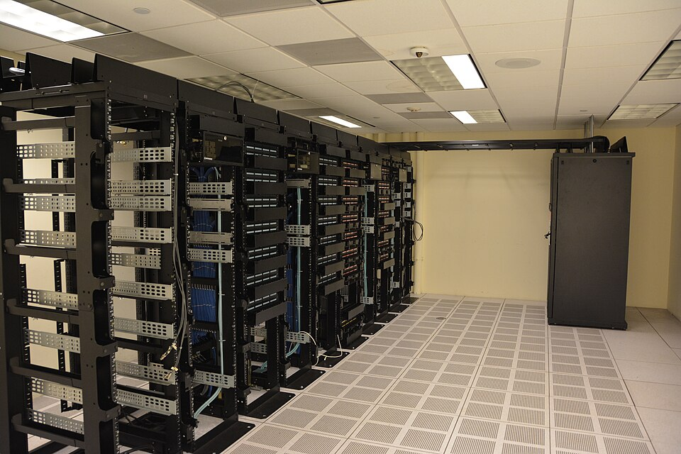

# Лекция 2.1. Типы данных и носителей: от архива до дата-центра

**Дисциплина:** Основы работы с информацией.  
**Тема 2.1:** Организация, хранение и использование данных.

**Цель лекции:** сформировать системное представление о видах данных, способах их организации, физических носителях и инфраструктуре хранения.

**Задачи:** научиться различать данные, форматы и носители; объяснять устройство основных средств хранения; понимать связь между структурой данных и возможностями поиска; выбирать принципы хранения с учётом назначения информации; различать архивирование, резервное копирование и синхронизацию.

## Введение

Представим два помещения. В первом стоят стеллажи с папками и коробками. Во втором — шкафы с серверами, накопителями и сетевым оборудованием. Внешне они почти не похожи. Однако в обоих случаях решается одна задача: сохранить сведения так, чтобы нужный человек мог найти их, понять и использовать.

Количество сохранённых документов само по себе не определяет качество хранения. Можно иметь тысячи файлов и не знать, какой из них является окончательной версией договора. Можно сохранить фотографию, но утратить сведения о месте и времени съёмки. Можно исправно копировать документы на накопитель, а затем обнаружить, что восстановить их невозможно. Следовательно, хранение информации включает не только размещение записей, но и организацию доступа, описание содержания и проверку сохранности.

В предыдущих темах информационная культура рассматривалась как осмысленная работа с информацией. Теперь обратимся к её материальной и организационной основе. Мы последовательно рассмотрим пять вопросов: что представляют собой данные; как они получают структуру; на чём записываются; как отдельные накопители объединяются в системы; что позволяет сохранять полезность данных на протяжении длительного времени.

Главная мысль лекции состоит в следующем: надёжное хранение возникает на пересечении трёх решений — подходящего представления данных, подходящей технической среды и понятных правил работы.

## 1. Данные и способы их представления

### 1.1. Информация, данные и контекст

**Информация** — сведения, которые получают смысл в определённом контексте и могут использоваться для понимания ситуации или принятия решения. **Данные** — зафиксированное представление сведений, пригодное для хранения, передачи и обработки. В компьютерной среде данные представлены цифровыми кодами.

Рассмотрим запись `21`. Это могут быть температура воздуха, возраст человека, номер аудитории или количество экземпляров книги. Последовательность символов остаётся одинаковой, но её смысл меняется. Чтобы правильно использовать запись, нужно знать, что измерено, в каких единицах, когда и каким способом.

Значение данных определяется не только записанными символами. Оно зависит от правил интерпретации. Число `03.04` в одном случае обозначает дату, в другом — десятичную дробь, в третьем — код раздела. Поэтому при организации хранения необходимо сохранять контекст вместе с содержанием.

**Метаданные** — данные, описывающие другие данные: их происхождение, структуру, назначение, свойства или условия использования. Для фотографии это могут быть дата съёмки, автор, разрешение и описание изображённого объекта. Для таблицы измерений — название показателя, единица измерения, источник и период наблюдения.

Метаданные бывают встроены в файл или хранятся отдельно, например в каталоге. Встроенная дата съёмки полезна, но не всегда достоверна: часы фотоаппарата могли быть настроены неверно. Следовательно, наличие метаданных не отменяет проверки их происхождения.

**Таблица 1 — Уровни описания одного информационного объекта**

| Уровень | Пример | На какой вопрос отвечает |
|---|---|---|
| Содержание | Фотография архивного документа | Что зафиксировано? |
| Метаданные | Название документа, дата, автор снимка | Как понять и найти объект? |
| Формат | JPEG | По каким правилам записано содержимое? |
| Файл | `opis_12_list_04.jpg` | Как объект представлен в файловой среде? |
| Носитель | SSD | Где физически записаны данные? |
| Система хранения | Файловый сервер учреждения | Кто и как получает доступ? |

Не следует называть фотографию, JPEG и SSD одинаковым термином «тип данных». Это разные уровни описания. Фотография характеризует содержание, JPEG — правила кодирования, а SSD — техническое средство хранения.

### 1.2. Аналоговое и цифровое представление

**Аналоговое представление** основано на изменении физической величины, соответствующем изменению исходного сигнала. Например, на магнитной аудиоленте может быть записан аналоговый звуковой сигнал. **Цифровое представление** использует дискретные значения, выраженные кодами.

При переводе непрерывного сигнала в цифровую форму выполняются два разных действия. **Дискретизация** означает выбор отдельных отсчётов по времени или пространству. **Квантование** означает представление измеренного значения одним из допустимых уровней. Далее значения кодируются и записываются.

Звуковой сигнал измеряют через определённые интервалы времени. Изображение при растровом представлении разбивают на элементы — пиксели. Увеличение числа отсчётов и точности их представления обычно увеличивает объём данных. Однако большой размер файла не гарантирует достоверность содержания: некачественный исходный материал нельзя сделать информативным одним увеличением разрешения.

Физический носитель и способ представления независимы. Магнитная лента может содержать аналоговую аудиозапись или цифровые данные. Бумага может нести рукописный текст либо напечатанный машиночитаемый код. Поэтому выражение «аналоговый носитель» часто является сокращением: точнее говорить о носителе с аналоговой записью.

Цифровую копию можно получить с точным совпадением последовательности битов. Но это требует исправного чтения и записи. Повреждение накопителя, ошибка программы или неправильное преобразование способны изменить результат. Именно поэтому важные копии проверяют.

### 1.3. Биты, байты и объём данных

**Бит** — двоичная единица, принимающая одно из двух значений: 0 или 1. **Байт** в современных компьютерных системах состоит из восьми битов. Последовательность битов может обозначать букву, число, цвет пикселя или часть звуковой записи — всё зависит от правил кодирования.

Восемь битов позволяют получить 256 различных комбинаций. Это количество комбинаций, а не обязательное количество символов в тексте. В современных текстовых кодировках символ может занимать различное число байтов. Поэтому нельзя считать, что любой текст из тысячи символов обязательно занимает тысячу байтов.

**Формула 1 — Количество комбинаций двоичного кода фиксированной длины**

`N = 2^n`,

где `n` — количество битов, а `N` — количество возможных комбинаций. Например, для восьми битов `N = 2^8 = 256`.

Следует различать десятичные и двоичные единицы объёма. Один килобайт, обозначаемый kB, равен 1000 байтам, а один кибибайт, KiB, — 1024 байтам. Соответственно, MB — миллион байтов, MiB — 1 048 576 байтов. В пользовательских интерфейсах обозначения иногда употребляются непоследовательно, поэтому сравнивать объёмы нужно с учётом способа подсчёта.

Отдельно различают биты и байты при оценке передачи. Скорость 100 мегабит в секунду соответствует теоретически 12,5 мегабайта в секунду до учёта служебного обмена и других ограничений. Совпадающее слово «мега» не делает эти величины равными.

### 1.4. Виды данных по содержанию

**Таблица 2 — Основные виды данных и особенности их представления**

| Вид | Что представляет | Примеры форматов | Существенная особенность |
|---|---|---|---|
| Текстовые | Последовательности символов | TXT, Markdown | Нужна корректная кодировка |
| Числовые | Количества, измерения, расчёты | CSV, таблицы базы данных | Важны единицы измерения и точность |
| Графические | Изображения и чертежи | JPEG, PNG, SVG, TIFF | Растровая и векторная модели различаются |
| Звуковые | Записи речи, музыки, сигналов | WAV, FLAC, MP3 | Существенны параметры записи и сжатия |
| Видео | Последовательности кадров, часто со звуком | MP4, WebM | Контейнер и кодек — разные понятия |
| Смешанные | Сочетание нескольких видов | PDF, DOCX, HTML | Требуется сохранять связи между элементами |

Один файл может объединять разные виды данных. Электронный учебник содержит текст, схемы и фотографии. Таблица может включать числа, даты и комментарии. Классификация по содержанию помогает понять характер информации, но не раскрывает всю её внутреннюю структуру.

Векторное изображение описывает геометрические объекты и их свойства. Растровое изображение представляет собой сетку пикселей. Поэтому схема из линий и подписей часто удобна в векторной форме, а фотография — в растровой. Выбор зависит от природы материала, а не от универсального превосходства одного подхода.

**Краткий конспект раздела.** Данные приобретают смысл в контексте. Метаданные помогают сохранить этот контекст. Вид содержания, формат и физический носитель описывают разные стороны объекта. Цифровая форма позволяет точно копировать запись, но требует контроля правильности операций.

## 2. Организация данных: от документа к базе данных

### 2.1. Структурированные, полуструктурированные и неструктурированные данные

Теперь перейдём от содержания к устройству записи. Одни и те же сведения можно изложить абзацем, представить таблицей или оформить как набор именованных полей. Возможности поиска и обработки будут различаться.

**Структурированные данные** организованы по заранее определённой схеме. Например, каждая запись каталога содержит инвентарный номер, название, автора и год издания. Схема задаёт допустимые поля, типы значений и связи между записями.

**Полуструктурированные данные** содержат явные обозначения элементов и связей, но допускают более гибкую организацию. Примерами служат документы JSON и XML. При этом конкретный JSON-документ можно строго проверять по схеме: граница между категориями зависит от правил использования.

**Неструктурированные данные** не имеют единой табличной схемы, непосредственно пригодной для типовых запросов. К ним обычно относят свободный текст, фотографии, звук и видео. Название не означает полного отсутствия структуры. У фотографии есть формат, у текста — предложения и абзацы. Речь идёт об отсутствии заранее заданного набора однотипных полей содержания.

**Таблица 3 — Одна тема в разных формах организации**

| Форма | Пример | Возможности и ограничения |
|---|---|---|
| Свободный текст | «В архив поступили письма за 1985 год» | Удобен для описания; отдельные сведения нужно извлекать |
| Таблица | Номер, вид документа, год поступления | Удобны фильтрация и сравнение записей |
| Документ с именованными полями | `{"type":"letter","year":1985}` | Поля доступны программе; правила нужно согласовать |
| Фотография документа | Изображение письма | Сохраняет внешний вид; поиск по словам требует распознавания или описания |

Наличие текста внутри изображения не превращает его в текстовые данные для поиска. Скан страницы может выглядеть как обычный документ, но программа видит пиксели. **Оптическое распознавание символов**, или OCR, преобразует изображение текста в символьное представление. Распознавание может содержать ошибки, поэтому значимые результаты проверяют по оригиналу.

### 2.2. Типы значений и качество записей

Внутри структурированных данных различают **типы значений**: целые числа, дробные числа, строки, логические значения, даты и другие. Тип определяет допустимые значения и операции.

Номер телефона состоит из цифр, но обычно хранится как строка. С ним не выполняют арифметические действия, а ведущий ноль или знак «плюс» может иметь значение. Аналогично, почтовый индекс и инвентарный номер не следует автоматически превращать в числа.

Для даты важно согласовать порядок компонентов. Запись `2026-11-12` удобнее для однозначного обмена, чем запись, допускающая разные трактовки дня и месяца. Но одного внешнего вида недостаточно: система должна понимать, что поле является датой, и проверять допустимость значения.

**Пропущенное значение** не равно нулю. Нулевое количество означает, что наблюдение выполнено и объектов нет. Отсутствующее количество означает, что сведения не получены или неприменимы. Если подменить пропуски нулями, среднее значение и другие расчёты могут оказаться неверными.

Качество данных включает точность, полноту, согласованность, актуальность и пригодность для конкретной задачи. Эти свойства связаны, но не совпадают. Полный список оборудования может содержать неверные серийные номера. Точная запись о местонахождении устройства может устареть после его перемещения.

### 2.3. Файл, каталог и формат

**Файл** — именованный объект хранения данных, которым управляет файловая система. **Каталог**, или папка, — средство организации имён файлов и других каталогов. **Файловая система** задаёт правила размещения, именования и доступа к файлам на логическом томе [1].

Путь указывает положение файла в иерархии каталогов. В дереве папок имя имеет смысл вместе с расположением. Два файла `otchet.pdf` могут существовать в разных каталогах, но одинаковые имена затрудняют работу после пересылки или объединения материалов.

**Формат файла** — правила организации и интерпретации записанных данных. **Расширение имени** — условное обозначение, которое часто указывает на формат. Переименование `document.jpg` в `document.pdf` не выполняет преобразование: внутреннее устройство файла не меняется.

Различают исходный редактируемый материал и представление для передачи или чтения. Текстовый документ удобно редактировать в одном формате, публиковать — в другом. Экспорт способен изменить свойства: интерактивные элементы могут перестать работать, формулы — превратиться в значения, а комментарии — исчезнуть. Поэтому важный исходник сохраняют отдельно от производной копии.

**Схема 1 — Уровни организации цифрового документа**

```text
Смысл: ведомость выдачи оборудования
                  ↓
Структура: получатель — устройство — дата — состояние
                  ↓
Представление: таблица в согласованном формате
                  ↓
Файл и каталог: Оборудование/2026/Выдача_2026-11.csv
                  ↓
Физическая запись: накопитель файлового сервера
                  ↓
Правила: доступ, версии, копирование, срок хранения
```

### 2.4. Архив, каталог и база данных

Слово **архив** имеет несколько значений. Это организация или собрание документов, предназначенных для сохранения; организованное цифровое хранилище; а также файл-контейнер, объединяющий другие файлы. Значение нужно уточнять по контексту.

Архив ZIP может объединять файлы со сжатием или без него. **Сжатие без потерь** позволяет точно восстановить исходные данные. **Сжатие с потерями** допускает необратимое изменение представления ради уменьшения объёма. Для текста договора или исходной таблицы допустимо только сохранение точного содержания. Для пользовательской копии фотографии иногда принимается уменьшение качества.

Уже сжатые изображения и видео нередко мало уменьшаются при дополнительной упаковке. Поэтому отсутствие заметного выигрыша в размере ZIP не свидетельствует об ошибке. Упаковка всё равно может быть полезна для объединения материалов.

Архив документов нуждается в учёте. **Каталог** в информационно-поисковом смысле — упорядоченное описание объектов, позволяющее находить их по признакам. Он может существовать в виде карточек, таблицы или базы данных. Каталог описывает объект и помогает получить доступ к нему, но не обязательно содержит сам объект.


*Рисунок 1 — Полки архива острова Святой Елены, Джеймстаун. Расположение и описание документов позволяют находить нужные материалы. Автор: Luke McKernan, 2018. [Оригинал и сведения об изображении](https://commons.wikimedia.org/wiki/File:Archive_shelves_(41054237191).jpg). Лицензия [CC BY-SA 2.0](https://creativecommons.org/licenses/by-sa/2.0/). Композиция и содержание сохранены; размер уменьшен до 960 × 640 пикселей.*

**База данных** — организованная совокупность взаимосвязанных данных. **Система управления базами данных**, или СУБД, — программная система для их определения, хранения, поиска и изменения.

В реляционной модели данные описывают отношениями, которые в учебном представлении удобно показывать таблицами. Эдгар Кодд изложил основы этой модели в статье 1970 года [2]. Существенная идея — описывать логические связи независимо от конкретного физического расположения записей.

**Ключ** позволяет идентифицировать запись или связывать записи. Фамилия человека обычно непригодна как единственный идентификатор: фамилии повторяются и могут изменяться. Устойчивый внутренний номер помогает отличать объекты даже при совпадении других характеристик.

При одновременной работе многих пользователей простого файла может оказаться недостаточно. СУБД управляет согласованностью изменений и поддерживает механизмы восстановления. Однако база данных тоже хранится на физических носителях и нуждается в резервных копиях.

**Краткий конспект раздела.** Структура делает возможными проверку и систематический поиск. Тип значения выбирают по смыслу, а не по внешнему виду. Файл, формат, каталог и база данных выполняют разные функции. Упаковка файлов не заменяет организацию архива и описание документов.

## 3. Физические носители и их свойства

### 3.1. Зачем данным материальная основа

Цифровая запись всегда связана с физическим состоянием материального объекта. Это могут быть магнитные свойства участка поверхности, электрическое состояние ячейки памяти или оптические свойства слоя диска. Слово «цифровой» обозначает способ представления, но не отсутствие материальной среды.

**Носитель данных** — материальная среда для записи и сохранения данных. **Накопитель** — устройство, обеспечивающее хранение и связанные с ним операции. В повседневной речи эти понятия часто сближают, но технически полезно их различать: магнитная лента является носителем, а ленточный привод — устройством чтения и записи.

Бумажный документ позволяет увидеть запись непосредственно. Цифровая запись требует цепочки средств: исправного носителя, совместимого устройства, программного обеспечения и знания формата. Если один элемент цепочки утрачен, физическая сохранность записи ещё не означает доступность её содержания.

### 3.2. Магнитные носители

**Жёсткий диск**, или HDD, использует вращающиеся пластины с магнитным покрытием и головки чтения и записи. Для обращения к нужному участку требуется механическое перемещение и ожидание поворота пластины. Поэтому характер запросов влияет на производительность [1].

Чтение одного большого последовательного файла и чтение множества небольших фрагментов в разных местах диска создают различную нагрузку. Одинаковый общий объём не означает одинаковое время выполнения. Это объясняет, почему накопитель может хорошо передавать большой видеофайл и медленнее обслуживать множество мелких обращений.

Магнитная лента также сохраняет данные за счёт магнитной записи. Её важная особенность — последовательный характер доступа. Чтобы получить определённый фрагмент, может потребоваться перемотка. Поэтому лента подходит для крупных потоков записи и архивных задач, где допустимо ожидание получения материала.

Лента не является исключительно исторической технологией. В крупных системах она применяется для долговременного хранения и резервного копирования. При оценке учитывают не только картридж, но и привод, библиотеку, программное обеспечение, персонал и порядок восстановления.

### 3.3. Полупроводниковая память

**Твердотельный накопитель**, или SSD, хранит данные в полупроводниковой памяти. В распространённых SSD используется флеш-память. Отсутствие механического позиционирования обычно обеспечивает меньшие задержки при случайных обращениях по сравнению с HDD.

Флеш-память имеет особенности записи и стирания. Ячейки обладают ограниченным ресурсом циклов, а контроллер распределяет операции, исправляет часть ошибок и управляет внутренними процессами. Поэтому ресурс SSD зависит от технологии, характера нагрузки и конструкции устройства. Само слово SSD не сообщает срок службы конкретной модели.

USB-флеш-накопители и карты памяти также используют полупроводниковую память, но отличаются контроллерами, интерфейсами, охлаждением и назначением. Нельзя переносить свойства дорогого серверного SSD на любую флешку только из-за общего физического принципа.

Флеш-накопитель удобен для переноса файлов, но его легко потерять. Разъём и корпус подвергаются механическим воздействиям. Поэтому удобство переноски не следует отождествлять с пригодностью для единственного экземпляра ценных материалов.

**Оперативная память**, или RAM, служит рабочей областью выполняющихся программ. Обычная оперативная память энергозависима: её содержимое не сохраняется при прекращении питания. Открытый в редакторе документ и сохранённый файл — разные состояния. Несохранённые изменения могут существовать только в рабочей памяти программы.

### 3.4. Оптические носители

Оптические диски читаются с помощью лазера. CD, DVD и Blu-ray различаются устройством и ёмкостью. Существуют носители только для чтения, для однократной записи и для перезаписи. Эти различия определяют возможные действия пользователя.

Оптический диск может быть полезен как отдельная копия, не подключённая постоянно к компьютеру. Но он требует совместимого привода и бережного обращения. Царапины, загрязнение, состояние записывающего слоя и условия хранения влияют на доступность записи.

Универсального обещания «любой диск хранится столько-то лет» недостаточно для проектирования архива. Результат зависит от конкретного носителя, качества записи, среды и последующих проверок. Долговременное хранение строят как управляемый процесс, а не как разовую покупку.

### 3.5. Сравнение носителей

**Таблица 4 — Назначение и ограничения носителей**

| Носитель | Принцип | Характерные задачи | Что учитывать |
|---|---|---|---|
| Бумага | Видимая запись на материале | Оригиналы документов, печатные фонды | Пожар, влажность, износ, трудоёмкость поиска |
| HDD | Магнитная запись на пластинах | Большие массивы файлов | Механические повреждения, задержки доступа |
| Магнитная лента | Магнитная запись на ленте | Архивные массивы, резервные копии | Последовательный доступ, необходимость привода |
| SSD | Полупроводниковая память | Активные данные, частые обращения | Ресурс записи, контроллер, условия эксплуатации |
| USB-флешка, карта памяти | Полупроводниковая память | Перенос и сбор данных | Потеря устройства, повреждение, качество исполнения |
| Оптический диск | Оптическое считывание | Распространение, отдельные копии | Совместимость приводов, состояние поверхности |

Носители сравнивают по ёмкости, задержке доступа, пропускной способности, ресурсу, условиям эксплуатации и стоимости владения. **Задержка** — время ожидания начала или завершения отдельного обращения. **Пропускная способность** — количество данных, передаваемых за единицу времени. Большая пропускная способность не гарантирует малую задержку каждого запроса.

Стоимость владения включает оборудование, электричество, обслуживание, замену, копирование и восстановление. Дешёвый накопитель может потребовать дорогой организации работы. Для архива, который открывают редко, допустимы одни компромиссы; для системы, обслуживающей множество запросов, — другие.

**Краткий конспект раздела.** Каждый цифровой объект имеет материальную основу. HDD, SSD, лента и оптический диск используют разные физические принципы. При выборе учитывают характер доступа, а также всю цепочку чтения и обслуживания. Единственного лучшего носителя для любых задач не существует.

## 4. Системы хранения: локальный компьютер, сервер, облако и дата-центр

### 4.1. От отдельного накопителя к общему ресурсу

Теперь увеличим масштаб рассмотрения. Пользователь видит папку или веб-страницу, но за ними может находиться сложная система оборудования. Для правильного понимания нужно различать физическое размещение и способ предоставления доступа.

**Локальное хранение** означает размещение данных на устройстве, непосредственно используемом человеком. Оно позволяет работать без постоянного сетевого соединения, но связывает доступность с состоянием этого устройства.

**Сервер** — компьютер или программная служба, предоставляющие ресурсы другим устройствам и программам. Файловый сервер обеспечивает общий доступ к файлам, сервер базы данных обслуживает запросы к данным, веб-сервер выдаёт содержимое по сетевым запросам. Один физический компьютер способен выполнять несколько серверных функций.

**Сетевое хранилище NAS** предоставляет файловый доступ через сеть. **Сеть хранения SAN** обычно обеспечивает доступ серверов к ресурсам хранения на блочном уровне. Пользователю учебного курса достаточно понимать различие масштаба: общая папка — это способ доступа, а внутри системы могут применяться разные технические решения.

### 4.2. Файловое, блочное и объектное хранение

При **файловом хранении** пользователь или программа работают с файлами и каталогами. При **блочном хранении** системе предоставляются адресуемые блоки, поверх которых она может создавать файловую систему или размещать данные иным способом. При **объектном хранении** данные представлены объектами с идентификаторами и метаданными, доступными через программный интерфейс.

Эти модели не являются последовательными ступенями качества. Они решают разные задачи. Файловая модель привычна для совместных документов. Блочная часто используется как основа серверных дисков. Объектная подходит для больших коллекций изображений, резервных копий и других самостоятельных объектов.

**Таблица 5 — Модели доступа к хранилищу**

| Модель | Основная единица | Как обычно обращаются | Пример задачи |
|---|---|---|---|
| Файловая | Файл в каталоге | По имени и пути | Общая папка отдела |
| Блочная | Адресуемый блок | Через систему ввода-вывода | Диск сервера для размещения файловой системы |
| Объектная | Объект с идентификатором | Через программный интерфейс | Коллекция фотографий с метаданными |

Папки в интерфейсе объектного сервиса могут быть способом отображения имён. Внешне похожие интерфейсы не гарантируют одинакового внутреннего устройства. Для пользователя важны доступные действия, ограничения и условия восстановления, а для администратора — ещё и свойства модели хранения.

### 4.3. Дата-центр как инфраструктура

**Центр обработки данных**, или **ЦОД**, также называемый дата-центром, — комплекс помещений, оборудования и инженерных систем, обеспечивающий размещение и работу вычислительных ресурсов. В его состав входят серверы, системы хранения, сеть, электропитание, охлаждение и средства физической защиты.

Оборудование потребляет электроэнергию и выделяет тепло. Если питание нестабильно или тепло не отводится, исправные накопители могут стать недоступны. Поэтому надёжность сервиса зависит не только от числа дисков, но и от инженерной среды, процедур обслуживания и действий персонала.

Стойка организует размещение оборудования. Сетевые устройства обеспечивают обмен. Системы питания помогают переживать определённые нарушения электроснабжения. Контроль температуры и состояния оборудования позволяет обнаруживать проблемы. Эти меры работают в пределах конкретного проекта: наличие дата-центра само по себе не гарантирует непрерывность любой услуги.



*Рисунок 2 — Серверные стойки в дата-центре. За сетевым доступом к данным находится физическая инфраструктура. Автор: Carl Lender, 2015. [Оригинал и сведения об изображении](https://commons.wikimedia.org/wiki/File:Datacenter_Server_Racks_(22370909788).jpg). Лицензия [CC BY 2.0](https://creativecommons.org/licenses/by/2.0/). Композиция и содержание сохранены; размер уменьшен до 960 × 640 пикселей.*

### 4.4. Что означает облачное хранение

**Облачные вычисления** — модель предоставления по сети доступа к общему пулу настраиваемых вычислительных ресурсов, которые можно оперативно выделять и освобождать. NIST выделяет такие признаки, как самообслуживание по требованию, сетевой доступ, объединение ресурсов, эластичность и измеряемость использования [3].

**Облачное хранилище** предоставляет хранение как сетевую услугу. Физически данные находятся на накопителях серверов. Пользователь управляет ими через приложение, браузер или программный интерфейс, не выбирая непосредственно конкретную пластину HDD или микросхему памяти.

Дата-центр и облако не являются синонимами. Дата-центр характеризует инфраструктуру, облако — модель предоставления ресурсов. Организация может разместить собственные серверы в ЦОД и не использовать облачную модель. Облачный поставщик, в свою очередь, может использовать несколько площадок.

**Схема 2 — Путь обращения к облачным данным**

```text
Пользователь и его учётная запись
                ↓
Приложение или браузер
                ↓
Сеть и проверка прав доступа
                ↓
Облачная служба хранения
                ↓
Серверы и системы хранения в дата-центре
                ↓
Физические накопители
```

Облачная модель уменьшает часть забот об оборудовании, но сохраняет задачи пользователя: правильно назначать доступ, понимать условия хранения, защищать учётную запись и иметь подходящий порядок восстановления. Число копий у поставщика, расположение данных и доступность истории версий зависят от конкретной услуги.

### 4.5. Доступность и согласованность

**Доступность** — возможность получить разрешённый доступ к данным, когда это требуется. **Репликация** — поддержание копий данных на нескольких узлах. Она может повышать доступность и распределять нагрузку, но не устраняет все виды потери.

Если пользователь ошибочно удаляет файл, система репликации может корректно распространить удаление на другие узлы. Все копии будут согласованы, но нужного файла уже не окажется. Следовательно, согласованность текущего состояния и возможность вернуть прошлое состояние — разные свойства.

При совместной работе также важны правила изменения. Два человека могут одновременно редактировать разные копии документа. Без механизма согласования возникают конфликты версий. Техническое решение должно дополняться организационным правилом: где находится основной экземпляр и кто отвечает за его утверждение.

**Краткий конспект раздела.** Сервер предоставляет ресурсы, ЦОД поддерживает работу оборудования, а облако задаёт модель предоставления услуг. Данные остаются на физических накопителях. Репликация помогает доступности, но для возврата к прежнему состоянию нужны отдельные механизмы.

## 5. Сохранность и использование данных на протяжении жизненного цикла

### 5.1. Жизненный цикл данных

Сохранение начинается до выбора накопителя. Нужно заранее определить, какие данные создаются, кто будет ими пользоваться, как долго они нужны и какие сведения помогут их понять. Модель жизненного цикла цифрового курирования DCC рассматривает сохранение как последовательность взаимосвязанных действий, включающих описание, отбор, хранение и повторное использование [4].

**Жизненный цикл данных** — последовательность состояний и действий от создания или получения до дальнейшего использования, архивного сохранения либо обоснованного удаления. На практике этапы могут повторяться: использование приводит к уточнению описания, исправлению ошибок и созданию новых версий.

**Схема 3 — Жизненный цикл и сквозные условия хранения**

```text
Создание или получение
          ↓
Проверка качества и описание
          ↓
Организация и рабочее хранение
          ↓
Использование и передача
          ↓
Оценка дальнейшей ценности
       ↙                 ↘
Архивное сохранение     Обоснованное удаление
       ↓
Проверка и перенос в новую среду
       ↓
Повторное использование

На всех этапах: ответственность, права доступа,
описание происхождения и контроль изменений.
```

Удаление является частью управления данными. Бесконечное накопление увеличивает затраты, затрудняет поиск и сохраняет ненужные риски доступа. Но решение об удалении принимают по назначению материалов и установленным требованиям, а не только по заполненности диска.

### 5.2. Архивирование, резервное копирование и синхронизация

**Архивирование** в организационном смысле — отбор и сохранение данных для длительного использования с необходимым описанием. **Резервное копирование** — создание копий, предназначенных для восстановления после утраты или повреждения. **Синхронизация** — согласование состояния данных между устройствами или каталогами.

Синхронизация удобна: изменение на компьютере появляется на другом устройстве. Однако ошибочное изменение тоже может распространиться. История версий или корзина сервиса иногда помогают восстановлению, но их наличие и глубину следует проверять.

**Таблица 6 — Разные задачи сохранения**

| Механизм | Основная цель | Типичный вопрос | Почему недостаточен сам по себе |
|---|---|---|---|
| Архивирование | Сохранить значимые материалы и контекст | Что понадобится в будущем? | Архив тоже может быть утрачен |
| Резервное копирование | Восстановить данные после потери | Как вернуть работоспособное состояние? | Копии требуют проверки и управления |
| Синхронизация | Поддерживать согласованное состояние | Как видеть актуальные изменения везде? | Может распространять удаление и повреждение |
| Репликация | Поддерживать копии на узлах | Как пережить часть отказов? | Может повторять логическую ошибку |
| RAID | Объединить накопители по выбранной схеме | Как организовать работу массива? | Некоторые уровни не имеют избыточности; массив не заменяет резервную копию |

**RAID** — способ объединения нескольких накопителей в массив с определённой организацией данных. Одни уровни повышают устойчивость к части отказов, другие ориентированы на производительность. Например, RAID 0 не обеспечивает избыточность. Даже устойчивый к отказу диска массив не защищает от всех ошибок пользователя, пожара или вредоносного изменения файлов.

Для запоминания принципов резервирования часто используют правило **3–2–1**: три экземпляра данных, включая рабочий, две разные среды хранения и один экземпляр отдельно от основной площадки. Это ориентир построения независимых копий, а не универсальная гарантия. Важно учитывать, могут ли одна авария или одна скомпрометированная учётная запись затронуть все экземпляры.

Библиотека Конгресса рекомендует давать документам понятные имена, организовывать их и держать копии в разных местах [5]. Для реального восстановления дополнительно нужны сведения о составе копии, времени её создания и порядке получения данных.

### 5.3. Проверка целостности и восстановление

**Целостность данных** — сохранение их правильности и согласованности в соответствии с установленными требованиями. Для контроля неизменности файла можно использовать **контрольную сумму**, в том числе криптографический хеш: значение, вычисляемое по его содержимому.

При проверке сравнивают сохранённое доверенное значение с вычисленным повторно. Несовпадение показывает, что проверяемое содержимое изменилось либо возникла ошибка в цепочке проверки. Само по себе оно не объясняет причину.

Хеш не восстанавливает повреждённый файл и не доказывает истинность записанных сведений. Если таблица изначально содержала ошибочные данные, её неизменность лишь подтверждает сохранение этой ошибки. Также хеш не устанавливает автора без дополнительных механизмов подтверждения происхождения.

**Схема 4 — Контроль копирования и возможность восстановления**

```text
Исходный файл → вычисление контрольного значения
      ↓                         ↓
Создание копии           Доверенная запись значения
      ↓                         ↓
Чтение копии → повторное вычисление → сравнение
                                      ↓
                         Совпадение / расследование ошибки

Если файл утрачен: восстановление из проверенной
независимой копии, затем проверка результата.
```

Наличие отчёта «копирование завершено» недостаточно. Проверка восстановления должна показать, что нужный объект найден, прочитан, открыт подходящей программой и пригоден для использования. Для базы данных может потребоваться согласованный комплект файлов или специальная процедура копирования, а не произвольное копирование части работающей системы.

Полезно определить допустимую потерю последних изменений и допустимую продолжительность восстановления. Если копирование выполняется раз в сутки, последние изменения между копиями могут оказаться невосстановимыми. Если архив занимает большой объём, его возвращение может потребовать существенного времени даже при исправной копии.

### 5.4. Долговременное сохранение и миграция

Срок существования данных может превышать срок службы устройства и популярности программы. **Миграция** — перенос данных на другую техническую платформу, носитель или в другое представление с контролем сохранения необходимых свойств.

Перенос на новый накопитель сохраняет доступность физической записи. Преобразование формата решает другую проблему — возможность интерпретации. Эти действия нельзя смешивать. Копирование файла устаревшего формата на современный SSD не обеспечивает появление программы, способной его открыть.

Выбирая формат для длительного хранения, рассматривают открытость описания, распространённость, наличие средств чтения, поддержку метаданных и соответствие содержанию. Открытый формат полезен, но не освобождает от проверок. Закрытый формат не всегда можно немедленно заменить без потери значимых свойств.

Для разных классов электронных документов используются разные подходы. PDF/A предназначен для архивного представления электронных документов при соблюдении требований соответствующего профиля. CSV прост для обмена таблицами, но сам по себе не сохраняет формулы, оформление и все сведения о типах. TIFF может применяться для изображений, FLAC — для звука без потерь. Выбор проверяют по задаче и свойствам конкретного файла [6].

После преобразования оценивают не только факт открытия, но и содержание. Важны количество страниц, читаемость подписей, сохранение изображений, точность числовых значений и наличие метаданных. Исходный файл полезно сохранять вместе с производной версией и описанием выполненного преобразования.

### 5.5. Права доступа и пригодность к использованию

Сохранность включает управление тем, кто может читать и менять данные. **Права доступа** определяют допустимые действия пользователя: просмотр, создание, изменение, удаление, назначение разрешений. Человеку предоставляют те возможности, которые нужны для его работы.

Управление доступом отличается от резервного копирования. Копия помогает после потери, но не предотвращает нежелательное чтение. Шифрование затрудняет чтение без ключа, но не заменяет копии. Потеря ключа может сделать сохранённый массив недоступным, поэтому порядок хранения ключей тоже требует организации.

Для использования важна понятность. Файл `final_new_2_really_final.docx` не сообщает, какой экземпляр утверждён. Последовательное именование, указание версии и статус документа помогают избежать ошибок. При этом имя не должно быть единственным местом хранения всей информации: подробные сведения размещают в каталоге или сопроводительном описании.

В учебной коллекции можно различать исходные материалы, рабочие версии и опубликованные результаты. Назначение папок должно быть понятно всем участникам. Не менее важно определить ответственного за обновление: технически исправное хранилище может содержать устаревшие сведения, если никто не поддерживает их актуальность.

### 5.6. Как выбрать подход к хранению

Выбор начинается с характеристик данных, а не с названия устройства. Сначала определяют ценность материалов, частоту обращения, объём, темп изменений, требования к доступу и последствия утраты. Затем выбирают сочетание технических и организационных средств.

**Таблица 7 — Связь требований и решений**

| Требование | Что следует предусмотреть |
|---|---|
| Материалы часто изменяются | Рабочую среду с управлением версиями и регулярным копированием |
| Документы должны храниться долго | Описание, подходящие форматы, периодическую проверку и миграцию |
| Пользователи работают совместно | Общий основной экземпляр, правила изменения и права доступа |
| Данные нужны после отказа устройства | Независимые копии и проверенный порядок восстановления |
| Коллекция велика, обращения редки | Архивный уровень с приемлемым временем получения |
| Сведения имеют ограничения доступа | Разграничение прав и соответствующие меры защиты |
| Материал будут использовать другие люди | Метаданные, описание полей, единиц и происхождения |

Рассмотрим учебный пример. Колледж сохраняет фотографии оборудования и таблицу его учёта. Фотографии размещаются как самостоятельные файлы, а таблица связывает их с инвентарными номерами. Рабочие материалы доступны ответственным сотрудникам, опубликованная подборка имеет отдельный статус. Резервные копии находятся независимо от рабочего устройства. Здесь нет одного носителя, который решает всё: результат обеспечивается согласованной системой.

**Краткий конспект раздела.** Сохранение данных требует отбора, описания, проверки и ответственности. Архивирование, синхронизация и резервное копирование имеют разные цели. Контрольная сумма обнаруживает изменение, но не восстанавливает содержание. Долговременная доступность поддерживается проверками и миграцией.

## 6. Заключение

Мы прошли путь от отдельной записи до инфраструктуры дата-центра. На каждом уровне возникал свой вопрос. Для данных — что они означают. Для структуры — какие связи и правила заданы. Для формата — как прочитать запись. Для носителя — каким физическим способом она сохраняется. Для системы — как организовать совместный доступ. Для жизненного цикла — как поддерживать ценность материалов во времени.

История развития хранения не сводится к замене старых носителей новыми. Бумажные документы, магнитные накопители, полупроводниковая память и сетевые сервисы продолжают использоваться одновременно. Каждая среда решает определённые задачи и требует соответствующих правил.

Важнейшие выводы можно сформулировать так:

1. Вид данных, формат файла, носитель и система хранения относятся к разным уровням описания.
2. Поиск и правильная интерпретация зависят от структуры, метаданных и качества записей.
3. Носитель выбирают по характеру нагрузки, условиям эксплуатации и требованиям восстановления.
4. Облачный доступ опирается на физические серверы и инженерную инфраструктуру.
5. Сохранённый файл должен оставаться читаемым, понятным и доступным уполномоченному пользователю.
6. Сохранность обеспечивается сочетанием независимых копий, проверок, управления доступом и организационной ответственности.

Дальнейшее изучение организации информации позволит подробнее рассмотреть поиск, классификацию, обработку и обмен данными. Эти действия будут эффективны тогда, когда материал правильно представлен и надёжно сохранён.

## 7. Глоссарий

| Термин | Определение |
|---|---|
| Данные | Зафиксированное представление сведений для хранения, передачи и обработки |
| Метаданные | Сведения о свойствах, происхождении, устройстве и использовании данных |
| Цифровое представление | Представление с помощью дискретных значений, выраженных кодами |
| Бит | Двоичная единица со значением 0 или 1 |
| Байт | Единица, состоящая из восьми битов |
| Формат | Правила организации и интерпретации данных |
| Файл | Именованный объект хранения, управляемый файловой системой |
| Файловая система | Правила и средства организации файлов и доступа к ним |
| Структурированные данные | Данные с заранее определённой схемой организации |
| База данных | Организованная совокупность взаимосвязанных данных |
| СУБД | Программная система управления базами данных |
| Носитель | Материальная среда записи и сохранения данных |
| HDD | Накопитель с магнитной записью на вращающихся пластинах |
| SSD | Накопитель на основе полупроводниковой памяти |
| Сервер | Устройство или служба, предоставляющие ресурсы другим участникам системы |
| ЦОД | Комплекс оборудования и инженерных систем для работы вычислительных ресурсов |
| Облачное хранилище | Предоставление хранения как сетевой услуги в облачной модели |
| Репликация | Поддержание копий данных на нескольких узлах |
| Синхронизация | Согласование состояния данных между устройствами или каталогами |
| Резервное копирование | Создание копий для последующего восстановления |
| Архивирование | Отбор и сохранение материалов для дальнейшего использования |
| Контрольная сумма | Вычисляемое по содержимому значение для контроля изменений |
| Миграция | Контролируемый перенос данных в новую среду или представление |

## 8. Вопросы для самопроверки

1. Чем данные отличаются от информации? Почему запись без контекста можно истолковать неверно?
2. Объясните различие между фотографией, форматом JPEG, файлом и SSD.
3. Чем структурированные данные отличаются от полуструктурированных и неструктурированных? Почему фотография текста не всегда доступна для поиска по словам?
4. Почему номер телефона обычно следует хранить как строку, а не как число? Чем пропущенное значение отличается от нуля?
5. Почему изменение расширения файла не преобразует его формат?
6. Какие особенности HDD, SSD и магнитной ленты влияют на выбор задач хранения?
7. Чем дата-центр отличается от облака? Где физически находятся облачные данные?
8. Почему синхронизация, репликация и RAID не заменяют резервного копирования?
9. Что позволяет установить контрольная сумма? Чего она не доказывает?
10. Какие действия позволяют сохранить доступность и понятность цифрового архива при смене оборудования и программ?

## 9. Литература и источники

1. Arpaci-Dusseau, R. H. Operating Systems: Three Easy Pieces / R. H. Arpaci-Dusseau, A. C. Arpaci-Dusseau. — Текст : электронный. — URL: https://pages.cs.wisc.edu/~remzi/OSTEP/ (дата обращения: 12.11.2026). — Для углублённого изучения: раздел Persistence, главы о файлах, дисках, RAID и SSD.
2. Codd, E. F. A Relational Model of Data for Large Shared Data Banks / E. F. Codd // Communications of the ACM. — 1970. — Vol. 13, no. 6. — P. 377–387. — DOI: 10.1145/362384.362685. — URL: https://research.ibm.com/publications/a-relational-model-of-data-for-large-shared-data-banks (дата обращения: 12.11.2026). — Текст : электронный.
3. Mell, P. The NIST Definition of Cloud Computing / P. Mell, T. Grance. — Gaithersburg : National Institute of Standards and Technology, 2011. — NIST Special Publication 800-145. — DOI: 10.6028/NIST.SP.800-145. — URL: https://csrc.nist.gov/pubs/sp/800/145/final (дата обращения: 12.11.2026). — Текст : электронный.
4. Curation Lifecycle Model / Digital Curation Centre. — URL: https://www.dcc.ac.uk/guidance/curation-lifecycle-model/ (дата обращения: 12.11.2026). — Текст : электронный.
5. Keeping Personal Digital Records / Library of Congress. — URL: https://digitalpreservation.gov/personalarchiving/records.html (дата обращения: 12.11.2026). — Текст : электронный.
6. Recommended Preservation Formats for Electronic Records / Smithsonian Institution Archives. — URL: https://siarchives.si.edu/what-we-do/digital-curation/recommended-preservation-formats-electronic-records (дата обращения: 12.11.2026). — Текст : электронный.
7. Shannon, C. E. A Mathematical Theory of Communication / C. E. Shannon // The Bell System Technical Journal. — 1948. — Vol. 27. — P. 379–423, 623–656. — URL: https://www.princeton.edu/~wbialek/rome/refs/shannon_48.pdf (дата обращения: 12.11.2026). — Текст : электронный. — Для углублённого изучения математических основ представления и передачи информации.
