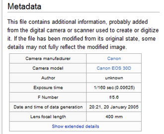
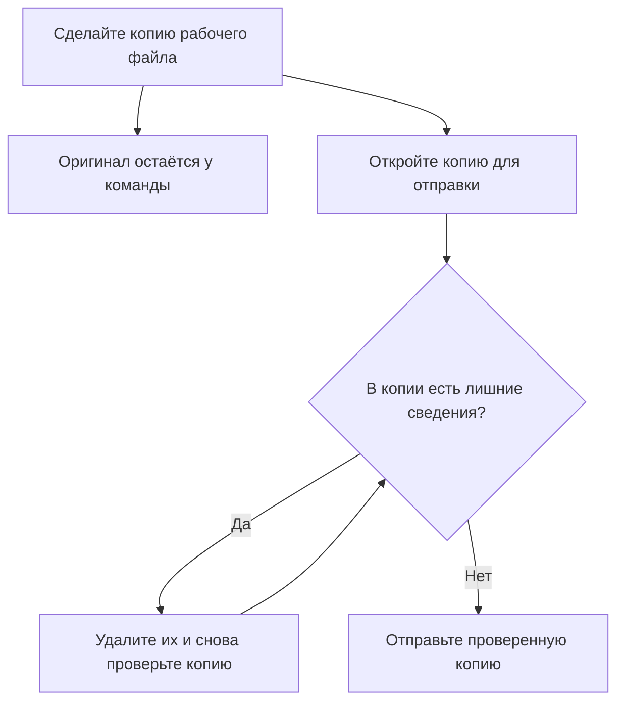
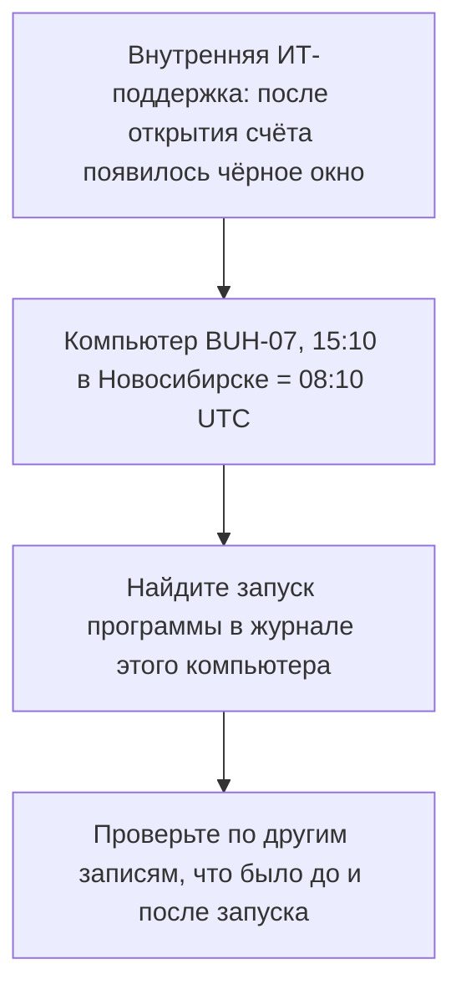

# Лекция 2.2. Метаданные: зачем нужны и как правильно задавать

**Дисциплина:** Основы работы с информацией.  
**Раздел 2:** Организация, хранение и использование данных.

После лекции вы сможете объяснить, какие сведения сопровождают файл, выбрать поля для каталога, проверить качество записи и решить, что можно передавать вместе с файлом.

## 1. Что можно узнать о файле до его открытия

Вы продаёте велосипед и отправляете покупателю фотографию. Велосипед виден сразу. Если телефон сохранил в файле координаты, получатель может узнать и место съёмки. Фото, сделанное во дворе, способно выдать адрес, даже если номер дома не попал в кадр.

**Метаданные** — сведения об объекте, которые помогают его найти, понять и правильно использовать. Дата съёмки отвечает на вопрос «когда?», координаты — «где?», размер изображения — «какого оно разрешения?». Содержание фотографии отвечает на другой вопрос — «что на ней видно?».

Один и тот же признак может быть полезным в одной задаче и лишним в другой. Координаты помогают найти снимки из поездки на карте. Для объявления обычно достаточно района, а точное место съёмки передавать незачем.

| Что хотим сделать | Какие поля помогут | Где это встречается |
| --- | --- | --- |
| Найти нужный материал | Название, тема, ключевые слова | Поиск конспекта в учебной папке |
| Понять, чем открыть файл | Формат, кодировка, размер | Импорт таблицы с данными |
| Разобраться в составе объекта | Номер страницы, порядок файлов, связь с оригиналом | Скан многостраничного договора |
| Управлять использованием | Лицензия, ответственный, уровень доступа | Каталог фотографий организации |
| Проверить сохранность | Контрольная сумма, дата проверки, версия | Хранение архивной копии |

Эти группы называют описательными, техническими, структурными и административными метаданными. В отдельную группу часто выделяют сведения для долговременного хранения. Границы зависят от задачи: дату можно использовать и для поиска, и для контроля срока хранения.

*Рисунок 1 — Карточный каталог помогает найти книгу до знакомства с её содержанием.*

**Вопрос группе.** В папке лежат два файла с названием «Отчёт.pdf». Какие сведения помогут выбрать нужный, если открывать файлы нельзя? Для поиска пригодятся учебная группа, период и название работы. Для отправки преподавателю могут дополнительно понадобиться статус согласования и версия.

## 2. Как договориться о полях и значениях

Представьте, что три человека заполняют один каталог фотографий. Один вводит в поле «Дата» день съёмки, другой — день загрузки, третий — день редактирования. Все значения выглядят как даты, но сортировка по такому столбцу не отвечает ни на один из трёх вопросов.

**Схема метаданных** описывает, какие поля есть у записи и что каждое означает. **Профиль применения** уточняет правила для конкретного каталога. Например, он задаёт обязательные поля и допустимые значения. Схема нужна прежде всего людям, которые заполняют, проверяют и переносят записи между системами.

### Одна фотография в каталоге колледжа

Колледж хранит снимки с мероприятий. Часть фотографий публикуют на сайте, часть оставляют в закрытом архиве. Для этой задачи можно завести такую запись.

| Поле | Правило | Пример |
| --- | --- | --- |
| Идентификатор | Уникален в каталоге, сохраняется при переименовании | PHOTO-0042 |
| Название | Коротко говорит, что на снимке | Выставка студенческих проектов |
| Дата съёмки | Год, месяц и день, если дата известна | 2026-10-21 |
| Дата загрузки | Заполняется системой при поступлении | 2026-10-23 |
| Статус публикации | Выбирается из утверждённого списка | На согласовании |
| Ответственный | Подразделение или сотрудник, который уточнит статус | Пресс-служба |
| Ссылка на файл | Указывает на место хранения | Путь в каталоге |

У идентификатора, названия и адреса разные задачи. Идентификатор отвечает на вопрос «какая запись?», название помогает её узнать, адрес даёт способ открыть файл. После переезда архива путь меняется, но запись можно найти по прежнему идентификатору. ISBN — знакомый пример идентификатора: разные издания одной книги могут иметь одинаковое название и разные ISBN.

*Рисунок 2 — Один ISBN представлен цифрами и штриховым кодом.*

Для статуса публикации удобен **контролируемый словарь** — согласованный список значений. Если один сотрудник пишет «одобрено», а другой «можно на сайт», фильтр по одному значению пропустит часть материалов. Список «на согласовании», «разрешено», «ограничено» позволяет фильтровать записи. Для описания того, что происходило на мероприятии, лучше оставить свободный текст.

При обмене данными проверяйте смысл поля, а затем его формат. Дата загрузки в одной системе может выглядеть точно так же, как дата съёмки в другой. Если известно только «октябрь 2026», не подставляйте первое число месяца. Сохраните точность до месяца, если схема это позволяет.

### Как сопоставить время из разных систем

**UTC (всемирное координированное время)** — международная шкала, от которой отсчитывают местное время. Нулевое смещение исторически связано с Гринвичем в Великобритании. Современную шкалу рассчитывает Международное бюро мер и весов по данным лабораторий разных стран. [Как устроено UTC](https://www.bipm.org/en/time-department/utc).

Представьте видеозвонок. В Новосибирске участник подключился в 15:10, а в Москве коллега увидел на часах 11:10. Это один и тот же момент. Новосибирское время опережает UTC на семь часов, московское — на три. Вычитаем смещение из местного времени и в обоих случаях получаем 08:10 UTC.

| Как записан момент | Что означает запись |
| --- | --- |
| `2026-11-19T15:10:00+07:00` | 19 ноября в 15:10 в Новосибирске |
| `2026-11-19T11:10:00+03:00` | 19 ноября в 11:10 в Москве |
| `2026-11-19T08:10:00Z` | Тот же момент в UTC. Буква `Z` обозначает нулевое смещение |

Буква `T` отделяет дату от времени. При переводе может измениться и дата. Например, 19 ноября в 02:30 по Томску соответствует 18 ноября в 19:30 UTC. Если в обращении написано только «около двух ночи», сначала уточните дату и местное время пользователя. Иначе есть риск искать событие в журнале за соседний день.

В рабочем каталоге указывайте, **к какому событию относится время**. У фотографии есть момент съёмки, у выгрузки — момент формирования, у журнала — момент события или получения записи. Даже одинаково оформленные метки с часовым поясом отвечают на разные вопросы.

### Карточка файла и словарь столбцов

Фотографию и список товаров удобно описать в двух слоях. Сначала составьте карточку ресурса, чтобы понять, кто передал файл и для чего он подходит. Затем, если это таблица, опишите её столбцы, чтобы коллега мог правильно обработать значения.

| Уровень описания | Какие поля пригодятся | Что это даёт |
| --- | --- | --- |
| Любой файл или набор | Идентификатор, название, формат, дата, источник, ответственный, доступ | Можно найти ресурс и понять, откуда он взялся и кому доступен |
| Фотография | Автор, дата съёмки, ширина и высота в пикселях, условия использования, связанный объект | Можно подобрать снимок для нужного товара и проверить условия публикации |
| CSV целиком | Дата выгрузки, кодировка, разделитель, наличие заголовков, версия | Можно открыть файл и разобрать строки ожидаемым способом |
| Столбец CSV | Название, смысл, тип значения, единица измерения, обязательность, правила проверки | Можно правильно прочитать число, обнаружить ошибку и обработать пропуск |

Для карточек удобно взять за основу распространённый словарь Dublin Core. В нём есть термины для названия, автора, идентификатора, формата и условий использования. Словарь задаёт смысл полей. При работе в группе их можно заполнить в электронной таблице, а для автоматического обмена описать в машиночитаемом формате. [Термины Dublin Core](https://www.dublincore.org/specifications/dublin-core/dcmi-terms/).

Представьте, что в CSV есть строка с артикулом B-014, ценой 890 и остатком 12. Значения 890 и 12 — данные о товаре. Сведения «цена выражена в рублях за штуку» и «остаток — целое число» — метаданные столбцов. Без этих пояснений получатель может принять цену за сумму по всей партии, а пустой остаток — за отсутствие товара. В спецификации CSV on the Web можно задать столбцы, типы и обязательность в отдельном JSON-описании. Таблица ниже показывает те же виды правил в форме, удобной для чтения человеком. [Руководство W3C по CSV on the Web](https://www.w3.org/TR/tabular-data-primer/).

| Поле | Что означает | Как читать и проверять |
| --- | --- | --- |
| Артикул | Код товара в системе | Текст. Должен присутствовать и быть уникальным в выгрузке |
| Цена | Цена одной единицы | Неотрицательное число в рублях за штуку |
| Остаток | Сколько единиц числится в момент выгрузки | Целое число от нуля. Пусто, если количество неизвестно |

Один артикул можно записать и в карточке фотографии, и в строке товара. Тогда связь переживёт переименование файла. Если компания ведёт несколько каталогов с одинаковыми артикулами, дополнительно потребуется указать каталог, в котором этот код имеет смысл.

**Вопрос группе.** В закрытой выгрузке есть остаток 12, а на сайте покупателю достаточно отметки «в наличии». Какой признак получит витрина для остатка 0? Что покажет для пустого значения?

**Задача для обсуждения.** Преподаватель просит вывести только материалы, готовые к публикации. Какое поле использовать? Что делать с пустым статусом? Пустое поле означает, что сведений нет. Для публикации нужно выяснить статус у ответственного.

## 3. Что именно уходит вместе с файлом

Описание может храниться внутри файла, в отдельном файле или в базе каталога. От места хранения зависит, какие сведения переживут пересылку. Например, метку «избранное» приложение может хранить в собственной базе. При отправке файла получатель тогда не увидит эту метку. Координаты снимка, записанные внутри файла, могут попасть к нему вместе с изображением.

*Рисунок 3 — У фотографии могут храниться модель камеры, дата и параметры съёмки.*

**Фото с телефона.** В приложении «Фото» на iPhone можно отключить передачу местоположения при отправке. Это позволяет сохранить исходный снимок для своего архива и поделиться копией без координат. Проверьте именно ту копию, которую собираетесь отправить. Адрес может быть виден и в самом кадре, например на табличке или посылке. [Руководство Apple по геоданным фото](https://support.apple.com/en-ie/guide/personal-safety/ips0d7a5df82/web).

**Рабочий пример. Документ для внешнего получателя.** Команда готовит коммерческое предложение в Word. В рабочем файле были комментарии о предельной скидке и правки к условиям. Когда правки перестали отображаться на экране, их могли просто скрыть настройкой отображения. Перед отправкой полезно сделать отдельную копию, проверить комментарии, исправления и свойства через инспектор документов и повторно открыть готовый файл. В рабочем экземпляре история изменений может быть нужна коллегам. [Инструкция Microsoft по инспектору документов](https://support.microsoft.com/en-gb/office/collab-files/remove-hidden-data-and-personal-information-by-inspecting-documents-presentations-or-workbooks?nochrome=true).

*Пример для фото: в оригинале координаты остаются, а покупателю отправляют проверенную копию без них.*

Статус «ограничено» в каталоге сообщает правило обращения с файлом. За фактический доступ отвечают настройки хранилища, например список пользователей, которым разрешено чтение. При проверке публикации посмотрите и на метку, и на доступ по ссылке.

## 4. Как метаданные помогают разбирать инциденты

**Хэш файла** — короткое значение, которое программа вычисляет по содержимому файла. Например, алгоритм SHA-256 даёт для файла результат фиксированной длины, даже если сам файл занимает несколько гигабайт. Если переименовать фотографию, её хэш останется прежним. Если обрезать фотографию и сохранить изменения, хэш изменится.

Хэш помогает проверить, сохранилась ли копия без изменений. Для этого сравнивают её хэш с заранее записанным хэшем оригинала. Оба значения нужно вычислить одним алгоритмом. Такой способ проверяет совпадение содержимого с оригиналом, которому доверяют.

В учебной ситуации сотрудник бухгалтерии в Новосибирске открыл приложенный к письму счёт. В 15:10 на рабочем компьютере `BUH-07` на секунду появилось чёрное окно с текстом и закрылось. Сотрудник сообщил об этом во внутреннюю ИТ-поддержку компании. Её специалисты помогают с рабочими компьютерами и проверяют подозрительные события. Окно могло появиться при запуске обычной программы, поэтому сначала нужно установить, что запустилось в этот момент.

**Sysmon** — инструмент Microsoft, который записывает выбранные события Windows в журнал. Журнал — это записи о действиях системы, которые можно просмотреть позже. Специалист ищет на `BUH-07` события около 08:10 UTC и проверяет, какая программа запустилась и какая программа её открыла. Если есть хэш файла, его можно сравнить с хэшем уже проверенной копии. Эти сведения помогают понять, совпал ли запуск с открытием счёта и что нужно проверить дальше. [Документация Microsoft о событиях Sysmon](https://learn.microsoft.com/en-us/windows/security/operating-system-security/sysmon/sysmon-events).

| Наблюдение | Что можно проверить дальше |
| --- | --- |
| Время в журнале указано как 08:10 UTC | Сопоставить с местным временем обращения |
| Известно имя компьютера | Найти записи именно с этого устройства |
| Видно, какой процесс запустил программу | Сравнить цепочку запуска с обычной работой программы |
| Есть хеш файла | Сопоставить его с уже исследованным экземпляром |

Имя программы легко перепутать с именем похожего файла. Хеш позволяет сравнить конкретное содержимое файлов. Одинаковый хеш по надёжному алгоритму даёт сильное основание считать содержимое одинаковым, но сам по себе не говорит, безопасна ли программа. Сопоставление времени тоже требует осторожности: часы могут расходиться, а часть событий может отсутствовать из-за настроек журналирования.

*Время и имя компьютера сужают поиск. Другие записи помогают проверить, связан ли найденный запуск с обращением.*

### Сохранить источник и объяснить изменения

Если специалист выгрузил журнал в таблицу и оставил только нужные строки, появляется производная копия. **Происхождение данных** показывает, откуда взяли исходник, кто и когда его выгрузил, какие преобразования выполнил. Благодаря этой записи коллега может проверить вывод по исходному журналу.

Например, к выгрузке прикладывают имя устройства, период, часовой пояс, дату получения и контрольную сумму оригинала. К рабочей копии добавляют сведения о фильтре. Если исходник передали через другой носитель, контрольную сумму проверяют повторно по ранее зафиксированному значению. Для сравнения должен использоваться тот же алгоритм.

**Вопрос группе.** В выгрузке есть десять строк, а в исходном журнале их тысячи. Что нужно записать, чтобы другой специалист получил те же десять строк? Укажите как минимум источник, интервал времени и условия отбора. Если часы двух устройств расходились, зафиксируйте, как это учли.

## 5. Как проверить запись перед использованием

Автоматическая проверка хорошо находит пустые обязательные поля, неверный формат даты и значения вне списка. Дальше нужен человек, который понимает задачу. Например, запись с датой съёмки «2026-10-21» проходит проверку формата. Если дата взята из свойств скачанного файла и относится к моменту загрузки, поле всё равно заполнено неверно.

При переносе каталога полезно начать с нескольких сложных записей. Возьмите объект с несколькими авторами, материал с ограниченным доступом и файл с неизвестной датой. После импорта проверьте, что авторы остались отдельными значениями, ограничения сохранились, а неизвестная дата не превратилась в вымышленную. Для обмена можно взять готовый словарь полей, например Dublin Core, и описать правила своего каталога поверх него.

Проверяйте вместе и файлы, и описания. Если после восстановления резервной копии документы открываются, но утрачены связи с их версиями и статусами, работа архива восстановлена лишь частично. Пробное восстановление нескольких записей покажет, сохранились ли сами файлы и возможность найти нужную версию.

## Заключение

Один и тот же набор сведений может помочь найти материал, объяснить ход инцидента или случайно раскрыть лишние данные. Начинайте с задачи и аудитории. Для учебного каталога важны понятные поля и согласованные значения. Для внешней отправки важна проверка копии. Для расследования важны источник, время и история обработки.
