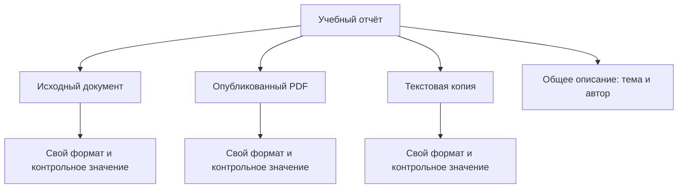
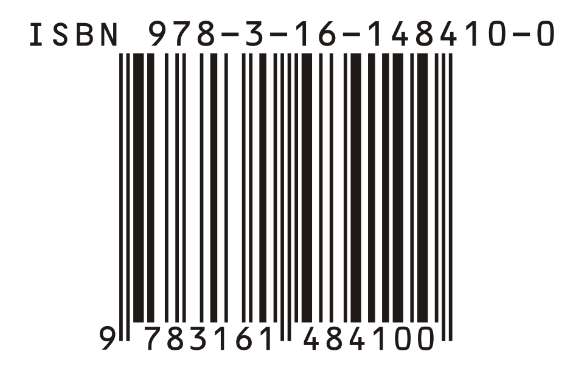
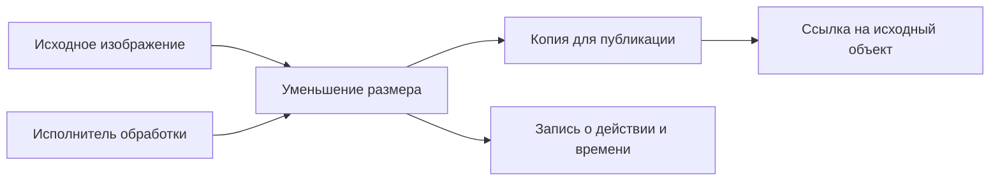
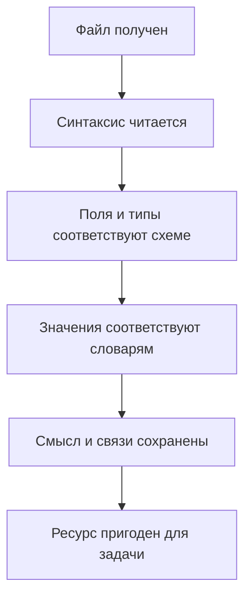
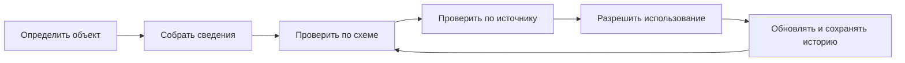

# Лекция 2.2. Метаданные: зачем нужны и как правильно задавать

**Дисциплина:** Основы работы с информацией.  
**Раздел 2:** Организация, хранение и использование данных.  
**Тема рабочей программы 2.1:** Организация, хранение и использование данных.

**Цель:** сформировать представление о метаданных как системе описания, поиска, интерпретации и управления информационными объектами.

**Результаты обучения:** объяснять назначение разных групп метаданных; отличать идентификатор от имени и адреса; выбирать поля описания под задачу; задавать значения по согласованным правилам; обнаруживать неполноту и противоречия; сохранять происхождение, связи и условия использования материалов.

## Введение

В предыдущей лекции мы различали содержание данных, формат файла, физический носитель и систему хранения. Теперь рассмотрим сведения, которые связывают эти уровни и помогают человеку работать с коллекцией материалов. Файл может исправно храниться на накопителе, но оставаться практически бесполезным: неизвестно, кто его создал, что означает его название, к какому периоду относятся данные и разрешено ли их передавать.

Представим папку с фотографиями оборудования. Имена файлов назначает камера, а изображения показывают внешнее устройство приборов. Однако по снимку трудно установить инвентарный номер, ответственное подразделение и статус публикации. Для учёта нужны дополнительные сведения. Если они записаны последовательно и связаны с соответствующими файлами, коллекция становится управляемым информационным ресурсом.

Метаданные позволяют отвечать на вопросы об объекте без полного изучения его содержимого. Но ценность описания зависит от правил: одинаково названные поля могут означать разные события, а разные названия — одну характеристику. Поэтому мы последовательно рассмотрим функции метаданных, устройство записи, правила значений, способы хранения и контроль качества. Главный предмет лекции — смысловая согласованность описания, а не запоминание интерфейса отдельной программы.

## 1. Назначение и виды метаданных

### 1.1. Данные об объекте

**Метаданные** — структурированные сведения, описывающие информационный объект, его свойства, происхождение, связи и условия использования. Информационным объектом может быть документ, фотография, аудиозапись, набор наблюдений или коллекция. Слово «структурированные» означает, что у описания есть различимые элементы и правила их интерпретации.

У одной фотографии есть изображённое содержание и описание. Фраза «насос после ремонта» относится к содержанию снимка, ширина в пикселях характеризует файл, а имя фотографа указывает на участие человека. Все эти сведения могут входить в метаданные, хотя отвечают на разные вопросы. Классификация помогает выбрать необходимые поля, а не смешивать их в одном комментарии.

Граница между данными и метаданными зависит от задачи. Каталог фотографий содержит метаданные по отношению к изображениям. Если исследователь изучает ошибки каталогизации, записи каталога становятся основными данными его исследования. Следовательно, метаданные определяются отношением к описываемому ресурсу, а не особым типом символов или обязательным расширением файла.

### 1.2. Описание существовало до компьютеров

Библиотечная карточка содержит название, автора, сведения об издании и указание места хранения. Читателю не требуется открывать каждую книгу, чтобы найти подходящую. Архивная опись и музейная этикетка решают сходную задачу. В цифровой среде описание дополнительно становится доступным для автоматического поиска, фильтрации и проверки.

*Рисунок 1 — Карточный библиотечный каталог как пример описания ресурсов отдельно от самих документов. Автор: Gregg, 2004. [Страница изображения](https://commons.wikimedia.org/wiki/File:Card_Catolog01.jpg). Лицензия [CC BY 2.0](https://creativecommons.org/licenses/by/2.0/). Изображение без изменений.*

Историческая преемственность важна: проблема поиска не возникла вместе с компьютером. Изменились масштаб коллекций, скорость обработки и способы обмена описаниями. Человек по-прежнему должен определить, что считать объектом, какие признаки существенны и как различать похожие экземпляры. Автоматизация ускоряет применение правил, но не выбирает их смысл вместо владельца коллекции.

### 1.3. Функции описания

Первая функция метаданных — обнаружение. Название, тема и ключевые слова позволяют отобрать потенциально подходящие объекты. Вторая — идентификация: установить, какой именно объект найден и отличается ли он от похожего. Третья — интерпретация: понять единицы измерения, временной охват и ограничения. Четвёртая — управление: определить ответственного, статус и допустимые действия.

Полнотекстовый поиск не решает все эти задачи. В тексте отчёта может встречаться слово «ноябрь», но это ещё не означает, что отчёт относится к ноябрю нужного года. У фотографии может не быть текстового слоя. Согласованное поле периода позволяет задавать запрос по определённому признаку независимо от случайных упоминаний в содержании.

Метаданные также поддерживают повторное использование. Получатель должен понять материал вне рабочей ситуации его автора. Для набора измерений недостаточно сохранить столбцы чисел: нужны названия показателей, единицы, способ получения и правила обработки пропусков. Здесь описание выполняет роль средства передачи знания о данных между людьми и системами.

### 1.4. Группы метаданных

**Описательные метаданные** помогают найти и распознать ресурс. **Структурные метаданные** задают отношения между его частями. **Административные метаданные** поддерживают управление. В административной группе часто выделяют технические сведения, сведения о правах и сохранении. Эти категории пересекаются: одну характеристику можно использовать для нескольких целей.

**Таблица 1 — Основные группы метаданных**

| Группа | Основной вопрос | Пример |
|---|---|---|
| Описательные | Что это и о чём? | Название, тема, автор |
| Структурные | Как связаны части? | Порядок страниц, принадлежность коллекции |
| Технические | Как устроен файл? | Формат, размер, кодировка |
| Управленческие | Каков статус и кто отвечает? | Версия, ответственный, дата проверки |
| О правах | Что разрешено? | Правообладатель, лицензия, ограничение доступа |
| О сохранении | Как обеспечивается долговременная доступность? | Контрольное значение, событие миграции |

Например, последовательность изображений страниц требуется для сборки электронной книги. Размер файла помогает планировать передачу, а также замечать неожиданные изменения. Дата проверки может быть полезна администратору и пользователю, оценивающему актуальность. Следовательно, классификацию следует применять как средство анализа функций, а не как набор непроницаемых ячеек.

### 1.5. Объект, запись и представление

**Ресурс** — объект, который описывают. **Запись метаданных** — связанный набор характеристик этого ресурса. **Представление ресурса** — конкретная форма, в которой доступно его содержание. Например, учебный отчёт может иметь исходный редактируемый файл, опубликованный PDF и текстовую копию для поиска.

Некоторые характеристики общие для всех представлений: тема, назначение и основной автор отчёта. Другие относятся только к конкретному файлу: размер, формат и контрольная сумма. Если смешать эти уровни, появится ложное противоречие: у одного отчёта окажутся сразу несколько размеров без пояснения, какой файл измеряли.

Поэтому перед заполнением полей определяют гранулярность — уровень подробности описания. Отдельная запись может относиться к коллекции, документу, версии, странице или файлу. Чем точнее определён объект записи, тем легче выбрать корректные значения и связи. Избыточная детализация тоже нежелательна: она увеличивает стоимость поддержки без гарантии пользы.

**Схема 1 — Ресурс и его представления**

**Краткий конспект раздела.** Метаданные помогают обнаруживать, идентифицировать, интерпретировать и сохранять ресурсы. Описание может храниться отдельно от объекта. Состав полей зависит от задачи и уровня описания. Сначала определяют ресурс, затем — относящиеся к нему характеристики.

## 2. Схема метаданных и правила записи

### 2.1. Поле, значение и семантика

**Поле** — именованный элемент описания определённой характеристики. **Значение поля** — конкретные сведения, записанные для объекта. **Семантика поля** — согласованный смысл этой характеристики. Например, поле `created_at` может обозначать создание информационного ресурса, а может — создание записи каталога. Совпадение технического имени не гарантирует совпадения смысла.

**Схема метаданных** определяет состав элементов, их связи и ограничения использования. Она задаёт, какие поля существуют, что они означают, какие значения допустимы и при каких условиях поле заполняют. Перечень заголовков таблицы является только частью схемы. Без определений и правил два исполнителя могут заполнить одинаковые столбцы несовместимым образом.

Хорошее определение поля позволяет исключить соседние трактовки. Вместо формулировки «Дата — дата файла» полезно записать: «Дата съёмки — календарная дата получения изображения камерой по подтверждённым данным». Тогда дата загрузки в каталог и дата копирования относятся к другим полям, даже если они совпадают с датой съёмки.

### 2.2. Словарь полей

**Словарь данных** — описание полей, типов, допустимых значений и правил заполнения. Его используют люди, которые создают записи, разрабатывают программы и принимают результаты обмена. Он должен быть достаточно конкретным для проверки, но не превращаться в пересказ всего содержимого каталога.

**Таблица 2 — Фрагмент словаря полей учебного каталога**

| Поле | Смысл | Тип и правило | Обязательность |
|---|---|---|---|
| `resource_id` | Постоянный идентификатор объекта | Строка, уникальна внутри каталога | Всегда |
| `title` | Понятное название содержания | Непустая строка | Всегда |
| `created_date` | Дата создания ресурса | Дата; неизвестное не выдумывать | При наличии подтверждения |
| `creator_id` | Идентификатор создателя | Ссылка на запись участника | При известном авторстве |
| `subject` | Тема ресурса | Значения согласованного словаря | Для тематического поиска |
| `access_status` | Допустимый режим доступа | Открытый, внутренний, ограниченный | Всегда |

Обязательность выбирают по задаче. Если каталог должен однозначно связывать описание с объектом, идентификатор необходим. Если точная дата неизвестна, требование обязательно заполнить её создаёт стимул записывать вымышленные сведения. Корректнее определить условия заполнения и способ обозначения неопределённости.

Словарь должен иметь ответственного и версию. Изменение смысла поля является изменением правил, даже если его имя осталось прежним. Старые записи нельзя автоматически считать соответствующими новой редакции. Требуется определить, какие значения совместимы, какие нужно проверить и как документировать выполненное преобразование.

### 2.3. Идентификатор, название и адрес

**Идентификатор** — обозначение, позволяющее однозначно ссылаться на объект в заданном контексте. **Название** помогает человеку распознать содержание. **Адрес** указывает способ или место доступа. Эти функции могут пересекаться, но их не следует считать взаимозаменяемыми.

Название «Отчёт по оборудованию» способно повторяться у разных документов. Путь к файлу меняется при перемещении. Поэтому внутренний идентификатор должен сохранять связь с объектом при переименовании и смене каталога. Например, `MEDIA-0042` можно оставить неизменным, а поле расположения обновить.

Уникальность всегда имеет границы. Номер `42` может быть уникален внутри одного каталога и повторяться в другом. При объединении коллекций добавляют контекст, используют разные пространства имён либо назначают глобально устойчивую систему идентификации. Префикс сам по себе не гарантирует уникальность: его также нужно согласовать и проверять.

*Рисунок 2 — Человекочитаемая запись ISBN и её машинное представление штриховым кодом. Автор файла: участник ISBN, 2007. [Страница изображения](https://commons.wikimedia.org/wiki/File:EAN-13-ISBN-13.svg). На странице указан статус public domain, PD-ineligible. Использовано готовое PNG-представление Wikimedia Commons, содержание не изменено.*

Идентификатор издания не обязательно идентифицирует физический экземпляр книги в библиотеке. Для экземпляра нужен собственный учётный номер. Аналогично, общий номер отчёта и идентификатор конкретного файла решают разные задачи. Прежде чем выбирать систему обозначений, необходимо установить, какой объект она должна различать.

### 2.4. Обязательность, повторяемость и ограничения

**Кардинальность** определяет допустимое количество значений элемента: ни одного, одно или несколько. У фотографии может быть несколько тематических рубрик и несколько участников создания. Если схема разрешает только одно имя, часть сведений окажется утрачена либо будет записана неструктурированной строкой.

Роли участников тоже различаются. Автор фотографии, редактор подписи и человек, загрузивший файл, не обязательно совпадают. Объединённое поле «Ответственный» скрывает эту разницу. Для управления лучше отдельно определить роль и участника, а при необходимости связать их с конкретным действием.

Ограничения могут касаться типа, длины, уникальности, набора значений и отношений полей. Например, дата окончания периода не должна предшествовать началу. Статус «опубликовано» может требовать заполненного источника и условий использования. Эти проверки выражают предметные правила, которые не следуют только из синтаксиса формата.

### 2.5. Стандарты и профиль применения

**Стандарт метаданных** согласует термины и правила в некоторой области. **Профиль применения** выбирает элементы стандарта и уточняет их использование для конкретной коллекции. Он может задавать обязательность, словари, ограничения и локальные расширения. Поэтому внедрение стандарта не означает обязательного заполнения всех возможных полей.

DCMI Metadata Terms содержит свойства для описания ресурсов, включая название, создателя, тему, идентификатор, связи и права. Термины имеют определения и устойчивые URI. При использовании стандарта важно опираться на эти определения, а не только переводить короткое имя свойства. Например, сведения о типе ресурса и формате его представления отвечают на разные вопросы [1].

Стандарт снижает стоимость согласования при обмене: участники могут ссылаться на общий смысл. Но он не гарантирует качество конкретной записи. Поле с правильным именем способно содержать неверное значение. Поэтому совместимость требует одновременно согласованных терминов, правил значений и контроля заполнения.

### 2.6. Составной объект и отношения между записями

Коллекция редко состоит из полностью независимых файлов. Методическое пособие включает главы, главы содержат страницы, а фотографии могут одновременно относиться к занятию и к инвентарному объекту. Для таких случаев недостаточно одного поля «Папка». Физическое расположение отражает выбранную организацию хранения, но не все смысловые отношения между материалами.

Отношение «часть целого» отличается от отношения «версия» и от отношения «создано на основе». Страница входит в документ, исправленный текст заменяет предыдущую редакцию, уменьшенная фотография производится из оригинала. Если все связи назвать одинаково, пользователь не сможет понять, нужно ли читать материалы вместе, выбирать один экземпляр или обращаться к источнику.

Для отношения сохраняют идентификаторы обоих объектов и определённый тип связи. Обратную связь иногда можно вычислить: если страница входит в документ, документ включает страницу. Но такое вычисление должно опираться на смысл отношения. Ссылку «связано с» нельзя автоматически трактовать как авторство, происхождение или принадлежность.

Особого внимания требует порядок частей. Алфавитная сортировка имён может поместить страницу 10 перед страницей 2. Числовое поле последовательности или явное структурное описание решает эту задачу независимо от отображаемого имени. Порядок является свойством составного объекта, а не случайным результатом сортировки файлового менеджера.

**Краткий конспект раздела.** Схема описывает состав полей и ограничения, словарь — их смысл и правила заполнения. Идентификатор отличает объект, название помогает пониманию, адрес обеспечивает доступ. Профиль применения адаптирует стандарт к задаче без произвольного изменения значений терминов.

## 3. Как задавать согласованные значения

### 3.1. Точность вместо внешнего единообразия

Две аккуратно оформленные записи могут иметь разную точность. Дата `2024-01-01` выглядит однозначно, но если известен только год, она создаёт ложное знание о дне и месяце. **Точность описания** означает соответствие значения подтверждённым сведениям. Оформление служит передаче этой точности, а не её имитации.

Различают неизвестное значение, неприменимость поля и намеренное ограничение раскрытия. Отсутствие координат может означать, что место съёмки не определено, геолокация не относится к объекту или сведения закрыты для публикации. Один пустой столбец не позволяет различить эти ситуации без дополнительных правил.

В простом каталоге можно использовать отдельный статус заполнения или оговорённые обозначения. Однако такие обозначения должны быть исключены из обычных значений. Если в числовом поле записать строку «нет данных», последующие вычисления потребуют специальной обработки. Способ кодирования пропусков выбирают вместе с форматом и назначением набора.

### 3.2. Даты, время и события

Дата создания содержания, дата публикации, дата изменения файла и дата регистрации записи — разные события. Они могут совпасть, но это нужно установить, а не предположить. Копирование файла способно повлиять на часть дат файловой системы, поэтому такую дату нельзя без проверки считать временем создания фотографии.

Для полной календарной даты удобно согласовать вид `ГГГГ-ММ-ДД`. Это устраняет неоднозначность порядка дня и месяца. Если известен только месяц, не следует подставлять первое число. Можно хранить год и месяц с отдельной характеристикой точности либо использовать предусмотренное схемой представление неполной даты.

Время события без часового пояса или смещения иногда неоднозначно. Записи `10:00` из разных мест нельзя автоматически упорядочить как события одного часового пояса. Для задач, где важна последовательность, согласуют полную временную отметку и контекст часовой зоны. При этом не каждая коллекция нуждается в точности до секунды.

**Таблица 3 — Как различать значения и неопределённость**

| Ситуация | Некорректное решение | Корректный принцип |
|---|---|---|
| Известен только год | Подставить 1 января | Сохранить год и точность |
| Автор не установлен | Назначить загрузившего файл | Отразить неизвестное авторство |
| Срока окончания нет | Записать случайную дату | Обозначить открытый период |
| Публикация запрещена | Оставить статус пустым | Указать ограничение доступа |
| Значение равно нулю | Считать его пропуском | Сохранить измеренный ноль |

### 3.3. Имена людей и организаций

Человека нельзя надёжно идентифицировать только по краткому имени. Совпадают фамилии, меняется написание, используются инициалы и псевдонимы. Для коллекции полезно разделить идентификатор участника, предпочтительную форму имени и варианты написания. Тогда исправление отображаемого имени не разрушит связи с ресурсами.

Для организаций важны изменения названия и структуры. Два документа могут указывать старое и новое наименование одного учреждения. Иногда это переименование, иногда — разные юридические лица или подразделения. Автоматическое объединение по сходству строк без проверки происхождения способно создать неверную связь.

**Авторитетная запись** в каталогизации — согласованная запись о лице, организации, теме или другом объекте, содержащая принятую форму и связанные сведения. Слово «авторитетная» здесь обозначает контроль единообразия, а не безусловную истинность любого утверждения. Источники и основания идентификации всё равно требуется сохранять.

### 3.4. Свободный текст и контролируемый словарь

**Свободный текст** позволяет описывать особенности конкретного объекта. Он полезен для аннотации и пояснения исключений. Но записи «фото», «фотография», «снимок» и `photo` могут обозначать один тип и мешать группировке по точному совпадению. Для повторяющихся признаков применяют согласованные значения.

**Контролируемый словарь** — управляемый набор терминов с правилами их использования. Он может быть простым списком статусов, иерархией рубрик или системой связанных понятий. Предпочтительный термин обеспечивает единообразие, а синонимы помогают найти это понятие по другим формулировкам [2].

Словарь нужно выбирать по учебной и рабочей задаче. Слишком широкая рубрика «техника» не различает материалы об оборудовании и программном обеспечении. Чрезмерно подробная иерархия требует от исполнителя знаний, которых у него может не быть. Хороший словарь поддерживает устойчивые различия, необходимые пользователям каталога.

Важна разница между классификацией и доказательством. Рубрика «достоверный источник» является результатом оценки по правилам, а не объективным техническим свойством файла. Если её используют, необходимо хранить критерий, автора оценки и дату. Иначе метаданные скрывают суждение под видом нейтрального факта.

### 3.5. Язык, единицы и координаты

Название, аннотация и ключевые слова могут существовать на нескольких языках. Следует понимать, какое значение относится к какому языку, и сохранять оригинальное название отдельно от перевода. Транслитерация имени также не заменяет оригинальную форму, если она доступна и нужна для точной идентификации.

Числовые характеристики требуют единиц. Число `120` может обозначать секунды, страницы, пиксели или мегабайты. Единица должна быть частью определения поля либо отдельной согласованной характеристикой. При объединении наборов одинаковые числа в разных единицах нельзя считать одинаковыми измерениями.

Географическое описание может содержать название места, административную принадлежность и координаты. Названия повторяются, границы меняются, а координаты имеют систему отсчёта и точность. Нельзя записывать точную точку на карте только потому, что известен город. Такая детализация создаст ложное впечатление точности и может иметь нежелательные последствия при публикации.

### 3.6. Название и аннотация

Название должно помогать отличать ресурс в списке результатов. «Изображение 15» удобно как машинная последовательность, но мало сообщает человеку. «Передняя панель учебного осциллографа после ремонта» передаёт содержание, если эти сведения подтверждены. При этом название не должно включать неподтверждённые выводы о состоянии устройства.

**Аннотация** — краткое связное описание содержания и существенных особенностей. Она дополняет название, но не обязана повторять все поля. Для набора данных полезно указать объект наблюдения, период, способ получения и важное ограничение. Для фотографии — что изображено и в каком контексте, когда это известно.

Отдельное поле для каждого смыслового признака поддерживает фильтрацию, а свободный текст объясняет нюансы. Нельзя полностью заменить одно другим. Строка «май, лаборатория, Иванов» читается человеком, но не задаёт, какой май имеется в виду и кем был Иванов: автором, изображённым человеком или ответственным за хранение.

**Краткий конспект раздела.** Значения должны отражать известные сведения с реальной точностью. Для дат различают события, для участников — идентичность и роль, для тем — понятия и варианты написания. Контролируемые значения поддерживают сравнение, свободный текст раскрывает контекст и ограничения.

## 4. Хранение, происхождение и обмен метаданными

### 4.1. Где находится описание

**Встроенные метаданные** располагаются внутри файла в предусмотренных его форматом структурах. Они перемещаются вместе с этим файлом, если операция сохраняет соответствующие структуры. **Внешние метаданные** хранятся в каталоге, базе данных или отдельном сопроводительном документе. Их нужно поддерживать в связи с объектом.

**Сопроводительный файл**, или sidecar, — отдельный файл описания, связанный с основным ресурсом. Он полезен, когда основной формат не поддерживает необходимые поля или когда исходный файл не хотят изменять. Но простого соседства в папке недостаточно: при переименовании и разделении файлов связь может потеряться.

**Таблица 4 — Способы размещения метаданных**

| Способ | Преимущество | Ограничение |
|---|---|---|
| Внутри файла | Описание переносится вместе с объектом | Редактор или сервис может удалить часть полей |
| В сопроводительном файле | Не требует изменения исходника | Нужно сохранять связь двух файлов |
| В каталоге или базе | Удобны поиск и централизованный контроль | Отдельная копия объекта может уйти без описания |

Выбор может быть комбинированным. Внутри изображения сохраняют авторство и основные технические характеристики, а в каталоге — историю проверки, связи с коллекцией и режим доступа. Важно определить, какая система является источником каждого поля. Иначе исправление в одном месте будет незаметно заменяться устаревшим значением из другого.

### 4.2. Технические и описательные сведения фотографии

Фотокамера может записывать настройки экспозиции, модель устройства и временные отметки. Такие сведения помогают понять техническую сторону получения изображения. Они не заменяют описание изображённого события, подтверждение личности автора или проверку прав. Ошибка часов камеры влияет на дату, а некоторые приложения изменяют или удаляют метаданные.

IPTC Photo Metadata определяет поля описательных, административных и правовых сведений об изображениях. В их числе сведения о создателе, описании содержания и условиях использования. Метаданные могут храниться внутри изображения, во внешней системе либо в сопроводительном файле [3]. Конкретный способ зависит от формата и программного процесса.

Нельзя предполагать, что отправка фотографии через любой сервис сохраняет все поля. Передача может включать уменьшение размера, перекодирование и удаление части описания. Поэтому при важном обмене проверяют выходной файл и сопроводительные сведения. Проверка исходника не доказывает, что получатель получил тот же комплект метаданных.

*Рисунок 3 — Пример отображения метаданных: поля камеры, даты и параметров съёмки. Это исторический снимок интерфейса, а не инструкция по современной версии сайта. Автор: Editor at Large, 2007. [Источник](https://commons.wikimedia.org/wiki/File:Metadata_screenshot.png). Общественное достояние, передано автором. Использована уменьшенная версия.*

На рисунке важно различать имена полей и их значения. Название камеры — техническая характеристика, время съёмки — запись определённого события. Даже автоматически полученная отметка времени требует проверки часов устройства. Отображение поля на странице не подтверждает истинность его значения и не устанавливает авторские права на фотографию.

*Рисунок 4 — Фотография каталога библиотеки NOAA как пример ресурса с отдельным описанием. Автор: Jennifer Fagan-Fry, 2016. [Источник и исходные метаданные](https://commons.wikimedia.org/wiki/File:NOAA_Central_Library_Card_Catalog_1.jpg). [CC BY-SA 4.0](https://creativecommons.org/licenses/by-sa/4.0/). Размер уменьшен; изображение предоставляется на той же лицензии.*

Для этого снимка страница источника указывает автора Jennifer Fagan-Fry, дату 26 сентября 2016 года и модель камеры Nexus 5X. Авторство относится к происхождению фотографии, модель — к техническим условиям, а слова «карточный каталог» описывают содержание. В уменьшенной копии встроенные EXIF-поля могут отсутствовать: поэтому сведения об источнике и лицензии сохранены в подписи. Не следует ожидать, что любая копия автоматически унаследует все поля оригинала.

### 4.3. Происхождение и история преобразований

**Происхождение данных**, или provenance, описывает, откуда получен ресурс и какие действия привели к его текущему состоянию. Существенны исходный объект, действие, участник и время события. Это позволяет отличать оригинал от производной версии и объяснять изменения содержания.

Модель PROV рассматривает сущности, действия и участников как основу представления происхождения [4]. Для учебной коллекции не обязательно реализовывать весь стандарт. Достаточно сохранять ясную связь: какое исходное изображение использовано, кто выполнил преобразование, что изменилось и где находится результат.

Например, уменьшенная копия фотографии не является побайтовой копией оригинала. У неё другое контрольное значение и, возможно, другие технические свойства. Автор изображённого содержания при этом не меняется автоматически. Участник обработки выполняет отдельную роль. Это различие необходимо для корректной атрибуции и управления версиями.

**Схема 2 — Происхождение производного файла**

### 4.4. Метаданные сохранения

Для долговременного хранения важно понимать не только содержание, но и выполненные операции. После проверки контрольных значений фиксируют результат, после миграции — исходный и целевой форматы, применённые средства и обнаруженные ограничения. Описание делает процесс сохранения проверяемым для следующего ответственного.

PREMIS — подход к метаданным цифрового сохранения, который связывает объекты, события, участников и права, необходимые для управления сохранением [5]. Вводному курсу важна логика: техническое действие должно оставлять понятное свидетельство, достаточное для объяснения состояния ресурса. Наличие записи о действии не заменяет проверку самого результата.

История может содержать ошибки, поэтому её тоже проверяют. Если миграция отмечена как успешная, но страницы не открываются, статус нельзя считать достаточным доказательством. Исправление результата и исправление записи о проверке — связанные, но отдельные действия. Надёжная история сохраняет основания решений, а не только положительные отметки.

### 4.5. Синтаксис и смысл при обмене

**Сериализация** — запись структурированных сведений в определённой форме для хранения или передачи. JSON, XML, YAML и CSV задают способы представления. Они не выбирают смысл полей вместо разработчика схемы. Корректно читаемый JSON способен содержать неизвестное поле, неверную единицу измерения и противоречивые даты.

**Схема 3 — Уровни проверки обмена**

Для CSV дополнительно согласуют разделитель, кодировку и представление повторяющихся значений. Если несколько авторов записаны через запятую в одной ячейке, получатель должен понимать, где граница между именами и частями имени. Формат допускает строки, но правила повторяемости всё равно требуется описать отдельно.

### 4.6. Сопоставление схем

**Сопоставление схем**, или crosswalk, определяет, как элементы одного описания переводятся в элементы другого. Однозначное соответствие возможно не всегда. Поле `author` одной системы может объединять создателя и редактора, тогда как другая система хранит их раздельно. Без дополнительного контекста нельзя восстановить разделение после объединения.

Простое переименование столбца не является доказательством совместимости. Нужно сравнить определения, типы, кардинальность, словари и уровень описания. Дата ресурса и дата каталожной записи имеют одинаковую внешнюю форму, но обозначают разные события. Их механическое объединение создаёт формально аккуратный и смыслово неверный набор.

DCAT описывает каталоги наборов данных и их доступные представления, поддерживая обмен описаниями между системами [6]. Полезное различие для этой лекции — набор как ресурс и его конкретная выгрузка. Один набор может быть доступен в нескольких форматах. У каждой выгрузки могут быть собственный адрес и технические характеристики.

### 4.7. Дублирование и выбор источника значения

Один и тот же признак может присутствовать во встроенной записи, сопроводительном файле и центральном каталоге. Такое повторение иногда повышает переносимость, но создаёт проблему согласования. Если имя автора изменили в каталоге, исходная фотография не обязательно обновится. При следующем импорте старое значение может вернуться и заменить исправленное.

Поэтому для каждого значимого поля устанавливают приоритет источников и условия обновления. Технический размер безопаснее измерить у конкретного файла. Название коллекции следует получать из управляемого каталога. Авторство уточняют по подтверждённым сведениям, а не выбирают автоматически по самой поздней временной отметке.

Конфликтующие значения не всегда можно разрешить голосованием большинства копий. Несколько каталогов могли получить сведения из одного ошибочного источника. Число повторений не делает их независимыми подтверждениями. При разборе конфликта важнее происхождение, компетентность источника и соответствие описываемому объекту.

Если определить правильное значение пока невозможно, полезно сохранить конфликт как состояние проверки. Например, два предполагаемых автора остаются кандидатами с указанием оснований. Публиковать одного как установленного создателя только ради заполнения обязательного поля нельзя. Временное ограничение записи точнее передаёт состояние знания.

### 4.8. Переносимость и резервирование описаний

Резервная копия коллекции должна учитывать не только основные файлы, но и связанные описания. Если сохранить изображения без каталога, можно утратить связи с инвентарными номерами. Если сохранить каталог без справочника участников, идентификаторы авторов останутся технически читаемыми, но перестанут быть понятными.

Состав резервируемого комплекта определяют по зависимостям: файлы, записи, словари, схема и правила интерпретации. Для восстановления важно знать, какие версии этих компонентов согласованы. Новая схема и старый набор значений могут не совпадать, даже если каждый файл по отдельности открывается.

Проверка переноса должна включать несколько характерных запросов. Находится ли ресурс по идентификатору? Сохранились ли несколько авторов? Правильно ли отображаются неполные даты? Доступен ли порядок страниц? Такие проверки оценивают сохранение функций каталога, а не только физическое наличие выгрузки.

При переходе между программами сначала испытывают небольшой представительный набор: обычную запись, запись с пропуском, объект с несколькими значениями и составной ресурс. Это позволяет обнаружить различия моделей до переноса всей коллекции. После исправления правил повторяют проверку затронутых свойств, фиксируя допустимые потери и ограничения.

**Краткий конспект раздела.** Метаданные бывают встроенными и внешними, поэтому связь с объектом нужно сохранять явно. Происхождение отражает ресурсы, действия и участников. При обмене отдельно проверяют синтаксис, структуру и смысл. Совместимость требует согласования схем, а не только открытия файла.

## 5. Качество, ответственность и жизненный цикл описания

### 5.1. Что означает качественная запись

**Качество метаданных** — степень пригодности описания для задач поиска, понимания и управления ресурсами. Оно включает полноту, правильность, согласованность, актуальность и возможность проследить происхождение. Эти характеристики не сводятся к единой оценке «заполнено»: заполненное поле может быть неверным.

Полноту измеряют относительно выбранного профиля. Если фотография используется только во внутреннем учёте, один набор признаков может быть достаточным. Для публичной передачи понадобятся проверенные условия использования. Следовательно, количество полей без указания задачи не является надёжным показателем качества.

**Таблица 5 — Измерения качества метаданных**

| Свойство | Контрольный вопрос | Пример дефекта |
|---|---|---|
| Полнота | Есть ли необходимые сведения? | Нет идентификатора ресурса |
| Правильность | Соответствует ли значение объекту? | Чужое имя автора |
| Согласованность | Не противоречат ли записи правилам? | Разные статусы одного значения |
| Актуальность | Отражает ли запись текущее состояние? | Старый адрес после переноса |
| Связность | Ведут ли ссылки к нужным объектам? | Карточка ссылается на другой файл |
| Прослеживаемость | Понятно ли основание значения? | Дата без указания источника |

### 5.2. Автоматическая проверка и предметная экспертиза

Автоматическая проверка может обнаружить пустое обязательное поле, неверный шаблон даты, повторяющийся идентификатор или значение вне словаря. Такие правила полезны, потому что применяются одинаково ко всему массиву. Однако они проверяют только те ограничения, которые определены и выражены в системе.

Программа легко принимает дату, которая существует в календаре, но не относится к объекту. Имя человека может быть написано без ошибок и всё же указывать не на автора. Значит, формальная корректность необходима для обработки, но недостаточна для достоверности. Существенные сведения сверяют с источником и содержанием.

**Валидация** — проверка соответствия установленным правилам. **Предметная проверка** оценивает правдоподобие и правильность содержания в контексте задачи. Они дополняют друг друга. Если правила не описывают реальную потребность, безупречное прохождение валидации не делает каталог полезным пользователям.

### 5.3. Количественные показатели

Для наблюдения за коллекцией можно вычислять долю записей с заполненными обязательными полями. При этом «заполнено» должно означать допустимое непустое значение, а не пробел, случайный знак или универсальное «неизвестно». Правила подсчёта фиксируют до сравнения результатов.

**Формула 1 — Доля заполнения обязательных элементов**

`C = N / M × 100 %`,

где `N` — количество корректно заполненных обязательных элементов в проверяемых записях, а `M` — количество элементов, обязательных для этих записей по профилю. Если `M = 0`, показатель по этой формуле не определяют. Условно обязательные поля учитывают только при выполнении соответствующих условий.

Например, в двадцати карточках требуется по пять полей. Всего ожидается сто значений. Если допустимыми непустыми значениями заполнено девяносто два поля, показатель составляет 92 %. Но это оценка заполнения, а не достоверности. Если во всех карточках указан один неверный автор, процент останется высоким.

Поэтому полезно раздельно отслеживать пропуски, дубликаты, нарушения словарей, неработающие связи и подтверждённые смысловые ошибки. Единый балл может скрыть проблему: высокий уровень заполнения названий не компенсирует отсутствие условий использования у материалов для публикации.

### 5.4. Права и ограничения раскрытия

Метаданные могут содержать сведения, которые не следует публиковать вместе с ресурсом. Географические координаты способны раскрыть место съёмки, фамилия — связать материал с человеком, технический идентификатор устройства — облегчить сопоставление записей. Решение о раскрытии принимают с учётом назначения и установленных оснований обработки.

Важно различать права на содержание и доступ к описанию. Разрешение просматривать карточку не обязательно означает разрешение скачивать файл. Обозначение автора не является лицензией. Отсутствие сведения о правообладателе не доказывает свободное использование. Каждое из этих утверждений относится к отдельной характеристике.

При публикации можно формировать публичное представление метаданных, исключающее внутренние поля. При этом исходная управленческая запись сохраняется в разрешённой среде. **Минимизация раскрытия** означает передачу сведений, необходимых для конкретной цели, а не механическое удаление всего описания. Авторство, контекст и условия использования часто необходимо сохранить.

### 5.5. Ответственность и изменения

Описание должно иметь владельца процесса: человека или подразделение, отвечающих за правила и исправления. Если никто не поддерживает словарь статусов, появятся новые варианты написания. Если перенос файлов не сопровождается обновлением адресов, каталог постепенно потеряет связи даже при хорошей первоначальной подготовке.

Изменения схемы следует отделять от исправлений отдельных записей. Исправление опечатки автора не меняет структуру коллекции. Разделение одного поля на два меняет правила и требует преобразования массива. Для таких изменений сохраняют версию схемы, дату введения и порядок обработки старых записей.

**Схема 4 — Жизненный цикл записи метаданных**

История изменений помогает объяснить, почему значение стало другим. Для существенной правки полезно сохранять предыдущее значение, основание, участника и время. Но журнал не должен бесконтрольно дублировать чувствительные сведения. Состав истории и условия доступа к ней также входят в правила управления коллекцией.

### 5.6. Профиль учебного каталога

Рассмотрим завершённую модель без привязки к конкретной программе. Колледж создаёт каталог учебных медиафайлов. Для каждого ресурса выделяется постоянный идентификатор. Человекочитаемое название описывает содержание. Темы выбираются из небольшого словаря, а ограничения доступа — из согласованного списка статусов.

Сведения об авторстве записываются при подтверждении. Для технических представлений отдельно фиксируются формат, размер и расположение. Производная копия связывается с исходным ресурсом. Условия публикации проверяются до открытия доступа, а отсутствие подтверждения не превращается в предположение о свободном использовании.

**Таблица 6 — Правила принятия записи в учебный каталог**

| Проверка | Условие приёмки | Действие при проблеме |
|---|---|---|
| Идентификация | Устойчивый уникальный ID | Устранить дубликат |
| Смысл | Название соответствует содержанию | Уточнить описание |
| Словари | Статусы и темы согласованы | Выбрать допустимое значение |
| Происхождение | Есть источник значимых сведений | Запросить подтверждение |
| Связи | Карточка указывает на нужный ресурс | Исправить связь |
| Публикация | Условия использования проверены | Сохранить ограниченный доступ |

Такой профиль позволяет постепенно увеличивать коллекцию без разрушения логики описания. Новое поле добавляют, когда оно поддерживает понятную задачу, а не потому, что доступно в интерфейсе. Старое поле удаляют только после оценки последствий для поиска, обмена и сохранения контекста.

### 5.7. Приоритет исправлений

Обнаруженные ошибки следует исправлять по влиянию на использование. Неработающая связь с единственным экземпляром документа может быть важнее различия регистра в ключевом слове. Непроверенное условие публикации требует внимания раньше, чем косметическое сокращение длинного названия. Приоритет связывают с последствиями, а не только с числом нарушений.

Полезно различать исправление значения и устранение причины. Если исполнитель постоянно путает дату съёмки с датой регистрации, недостаточно вручную поправить несколько карточек. Нужно уточнить определение поля, подпись в форме и правило проверки. Иначе новая партия данных воспроизведёт тот же дефект.

Для контроля изменений выбирают небольшой набор эталонных случаев, содержащий характерные исключения. После изменения словаря или преобразования проверяют, что ранее правильно обработанные ситуации сохранили смысл. Такой набор не заменяет проверки всей коллекции, но помогает обнаружить ухудшение правил, которое легко пропустить при просмотре обычных записей.

Обратная связь от пользователей также является источником оценки качества. Если люди регулярно находят подходящие материалы только через личные сообщения автору, формально заполненный каталог не выполняет задачу. Нужно выяснить, каких признаков не хватает, как пользователи формулируют запросы и какие различия важны для их решений.

**Краткий конспект раздела.** Качество определяется пригодностью к задаче. Заполненность, достоверность и согласованность оцениваются отдельно. Формальные проверки дополняются сверкой источников. Ответственность, история и ограничения раскрытия поддерживают полезность описания после его первоначального создания.

## Заключение

Метаданные превращают отдельные файлы в связанные и понятные ресурсы. Они обеспечивают поиск по устойчивым признакам, помогают установить происхождение и поддерживают решения о хранении, доступе и публикации. Но описание выполняет эти функции только при согласованных значениях и проверяемых основаниях.

Последовательность работы начинается с определения объекта и задачи. Затем выбирают характеристики, задают правила значений, обеспечивают связь записи с ресурсом и проверяют результат. Стандарт предоставляет общие термины, профиль применения уточняет местные требования, а словарь полей делает их понятными исполнителю.

Ключевые положения лекции:

1. Описание ресурса зависит от цели использования и уровня подробности.
2. Имя, идентификатор и адрес выполняют разные функции.
3. Неизвестные сведения следует обозначать честно, сохраняя реальную точность.
4. Форма файла не гарантирует сохранения смысла при обмене.
5. Происхождение, права и история изменений требуют явного описания.
6. Качество поддерживается проверками и ответственностью на протяжении всего жизненного цикла.

Следующая тема — каталогизация и индексирование. Знание метаданных позволит объяснить, как записи объединяются в каталог, как классификация поддерживает поиск и почему технический индекс не заменяет качественного описания.

## Глоссарий

| Термин | Краткое определение |
|---|---|
| Метаданные | Сведения, описывающие ресурс, его свойства, связи и использование |
| Ресурс | Объект, на который направлено описание |
| Запись метаданных | Связанный набор характеристик ресурса |
| Поле | Элемент описания конкретной характеристики |
| Семантика | Согласованный смысл элемента или значения |
| Схема метаданных | Состав элементов, отношений и ограничений описания |
| Словарь данных | Определения полей, типов и правил заполнения |
| Профиль применения | Уточнение использования выбранных элементов для коллекции |
| Идентификатор | Однозначное обозначение объекта в определённом контексте |
| Кардинальность | Допустимое количество значений элемента |
| Контролируемый словарь | Управляемый набор терминов и правил их использования |
| Авторитетная запись | Согласованная запись об идентифицируемом лице, теме или организации |
| Сопроводительный файл | Внешний файл описания, связанный с основным ресурсом |
| Происхождение данных | Сведения об источниках и действиях, сформировавших ресурс |
| Сериализация | Запись структурированных сведений в определённой форме |
| Сопоставление схем | Правила перевода между элементами разных описаний |
| Валидация | Проверка соответствия установленным ограничениям |

## Вопросы для самопроверки

1. Почему сведения одного каталога могут быть метаданными в одной задаче и основными данными в другой?
2. Чем различаются описательные, структурные и административные характеристики?
3. Почему состав полей нельзя выбирать до определения описываемого объекта?
4. Чем идентификатор отличается от названия и адреса? Когда важны границы его уникальности?
5. Какие правила, кроме названия и типа поля, должен содержать словарь данных?
6. Как корректно описать фотографию, если известен только год съёмки и не установлен автор?
7. Какие задачи решает контролируемый словарь и для чего нужен свободный текст?
8. Почему правильно читаемый JSON не гарантирует смысловой совместимости записей?
9. Чем показатель заполнения отличается от проверки достоверности?
10. Какие метаданные необходимо проверить перед публикацией и какие сведения могут потребовать ограничения доступа?

## Литература и источники

1. DCMI Metadata Terms / DCMI Usage Board. — URL: https://www.dublincore.org/specifications/dublin-core/dcmi-terms/ (дата обращения: 17.11.2026). — Текст : электронный.
2. Baca, M. Introduction to Metadata / edited by M. Baca. — 3rd ed. — Los Angeles : Getty Research Institute, 2016. — URL: https://www.getty.edu/publications/intrometadata/ (дата обращения: 17.11.2026). — Текст : электронный.
3. What is Photo Metadata / International Press Telecommunications Council. — URL: https://iptc.org/standards/photo-metadata/photo-metadata/ (дата обращения: 17.11.2026). — Текст : электронный.
4. PROV-Overview: An Overview of the PROV Family of Documents / W3C. — 2013. — URL: https://www.w3.org/TR/prov-overview/ (дата обращения: 17.11.2026). — Текст : электронный.
5. PREMIS: Preservation Metadata Maintenance Activity / Library of Congress. — URL: https://www.loc.gov/standards/premis/ (дата обращения: 17.11.2026). — Текст : электронный.
6. Data Catalog Vocabulary (DCAT) — Version 3 / W3C. — URL: https://www.w3.org/TR/vocab-dcat-3/ (дата обращения: 17.11.2026). — Текст : электронный.
7. METS: An Overview and Tutorial / Library of Congress. — URL: https://www.loc.gov/standards/mets/METSOverview.v3_en.html (дата обращения: 17.11.2026). — Текст : электронный. — Для изучения связей между файлами и структурой цифрового объекта.
