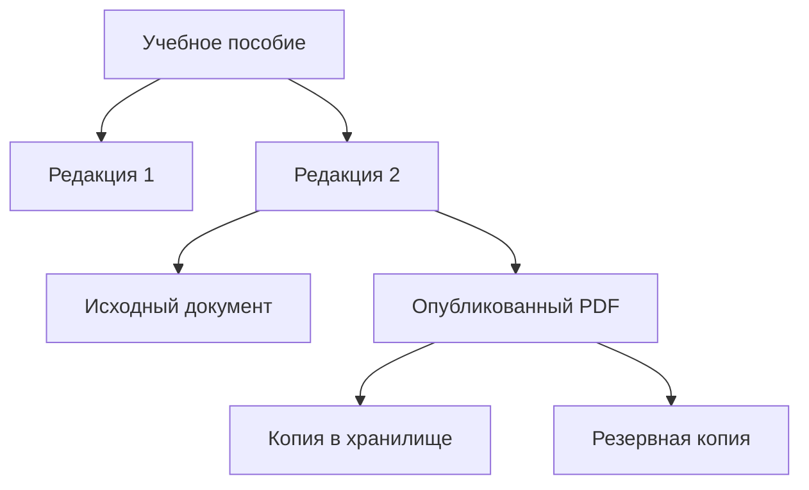
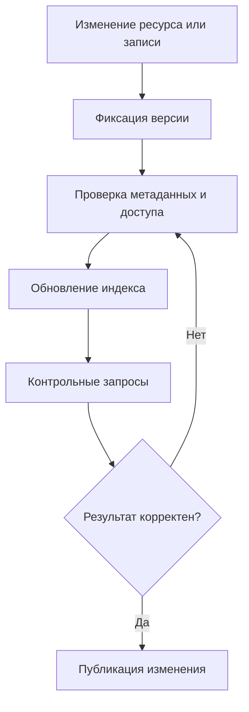

# Лекция 2.3. Принципы каталогизации и индексирования

**Дисциплина:** «Основы работы с информацией».  
**Раздел:** «Организация, хранение и использование данных».  
**Цель:** объяснить, как описания ресурсов превращаются в управляемый каталог и как поисковый индекс помогает находить нужные материалы.

**Результаты обучения:** различать каталог, классификацию, указатель и поисковый индекс; определять единицу каталогизации; выбирать точки доступа; объяснять устройство инвертированного индекса; применять простые операции поиска; оценивать полноту и точность выдачи; учитывать обновление и ограничения доступа.

## Введение

В предыдущей лекции рассматривались метаданные: сведения об авторе, названии, теме, происхождении и свойствах ресурса. Однако наличие описаний ещё не гарантирует удобного поиска. Если одинаковые авторы записаны по-разному, темы назначены случайно, а ссылки ведут к устаревшим копиям, пользователь будет получать неполные или ошибочные результаты. Организация коллекции требует согласовать описание отдельных объектов, связи между ними и способы обращения к сведениям.

Представим электронный архив колледжа. В нём есть учебные пособия, фотографии мероприятий, отчёты и образцы документов. Один пользователь знает фамилию автора, второй ищет всё о резервном копировании, третий хочет получить действующую редакцию положения. Для этих запросов нужны разные признаки. Поиск только по имени файла не решает все задачи: имя может не содержать тему, а одинаковые имена могут принадлежать разным ресурсам.

Каталогизация определяет, что описывается и как записи согласуются. Классификация помогает группировать объекты. Предметное индексирование раскрывает содержание через термины. Техническое индексирование строит структуры для поиска. Эти процессы связаны, но у каждого своя функция. Далее они рассматриваются на примере небольшой учебной коллекции; примеры записей и результатов специально составлены для объяснения.

## 1. Каталог и единица описания

### 1.1. Что делает каталог

**Каталог** — организованная совокупность записей о ресурсах, поддерживающая их обнаружение, различение и выбор. В зависимости от задачи каталог также показывает местонахождение, доступность, связи и условия получения. Его назначение шире хранения перечня названий. Пользователю важно понять, существует ли подходящий материал, относится ли описание к нужной версии и можно ли воспользоваться найденным объектом.

Каталог может быть карточным, табличным или представленным в информационной системе. Форма влияет на удобство обновления, но не отменяет требований к смыслу записей. Электронная таблица с едиными полями и устойчивыми идентификаторами способна выполнять функцию небольшого каталога. Сложная система с противоречивыми записями может выполнять её плохо. Поэтому качество организации нельзя оценивать только по наличию поисковой строки.

*Рисунок 1 — Карточный каталог: записи организованы для последовательного поиска по принятым признакам. На фотографии — каталог регистраций авторского права Библиотеки Конгресса, а не универсальная классификация знаний. Автор: Michael Holley, 2009. [Источник](https://commons.wikimedia.org/wiki/File:Copyright_Card_Catalog_Files.jpg). Общественное достояние, передано автором. Размер уменьшен.*

На рисунке видна физическая организация доступа: ящики имеют обозначения, карточки расположены в определённом порядке. В электронной среде вместо перемещения карточек система поддерживает несколько представлений одних записей. Это позволяет искать по автору и по теме без создания независимых копий всего каталога. При этом правила сортировки и состав доступных признаков по-прежнему необходимо определить.

### 1.2. Четыре понятия, которые нельзя смешивать

**Каталогизация** — создание и ведение согласованных записей о ресурсах по выбранным правилам. Она включает определение объекта описания, идентификацию, заполнение метаданных, установление связей и контроль качества. **Классификация** — распределение объектов по классам на основании выбранных признаков. Она отвечает на вопрос, к каким группам относится ресурс, но не заменяет его индивидуальное описание.

**Указатель** — упорядоченный набор обозначений с отсылками к материалам или их частям. Предметный указатель книги связывает понятия со страницами. **Поисковый индекс** — структура данных, которая связывает поисковые признаки с идентификаторами документов или других единиц поиска. Термин «индекс» имеет несколько значений; его смысл всегда определяется контекстом.

**Таблица 1 — Средства организации коллекции**

| Средство | Основной вопрос | Пример |
|---|---|---|
| Каталог | Какие ресурсы представлены? | Запись о пособии и его версиях |
| Классификация | К какой группе относится ресурс? | Пособие относится к хранению данных |
| Указатель | Где раскрывается понятие? | «Резервирование» — страницы 12, 35 |
| Поисковый индекс | Какие документы отвечают признаку? | Термин «архив» связан с D1 и D3 |

Таблица показывает разные функции, а не конкурирующие варианты одного инструмента. Каталог может использовать классификацию, включать указатели и обслуживаться несколькими техническими индексами. Изменение одной части не обязательно требует заменить остальные. Например, ускорение индекса не исправляет неверно указанного автора, а новая рубрика не восстанавливает потерянный файл.

### 1.3. Сначала определить объект

**Единица каталогизации** — объект, на который создаётся самостоятельная запись. В одной коллекции это книга, в другой — статья, фотография, набор данных или отдельная редакция документа. Выбор определяет число записей, состав полей и возможные запросы. До заполнения карточек нужно договориться, что считается самостоятельным объектом и какие части описываются только внутри общей записи.

Учебное пособие может существовать в виде исходного документа и опубликованного PDF. Если задача — найти содержание пособия, разумно связать оба файла с общей записью ресурса. Если необходимо контролировать происхождение каждого файла, нужны также отдельные сведения о представлениях. Создание двух несвязанных записей с одинаковым названием затруднит выбор: пользователь не поймёт, это два произведения или два формата одного материала.

Для периодического отчёта единицей может быть отдельный выпуск. Для сборника статей иногда достаточно записи сборника, но поиск по авторам отдельных статей потребует более подробного описания. Решение зависит от информационных потребностей. Детализация имеет стоимость: каждую запись нужно проверять и поддерживать. Поэтому принцип «описывать как можно мельче» не является универсально правильным.

### 1.4. Идентичность, версия и экземпляр

Название помогает человеку узнать ресурс, но не гарантирует уникальность. Два отчёта могут называться одинаково, один документ может менять заголовок, а копии могут иметь разные имена файлов. **Идентификатор записи** однозначно обозначает запись в установленной области. Идентификатор ресурса и идентификатор его файла могут различаться: важно явно определить, к чему относится каждый из них.

**Версия** отражает состояние содержания или описания после изменения. **Экземпляр** — конкретная копия ресурса. Два одинаковых PDF на разных носителях могут быть экземплярами одного представления. Две редакции положения содержат разные состояния документа. Их нельзя объединять только по совпадающему названию. Пользователю нужны признаки редакции, статуса и связи с предшествующим вариантом.

Контрольная сумма помогает сравнивать байтовое содержимое файлов, но не решает все вопросы идентичности. Разные файлы могут содержать одно и то же произведение в разных форматах. Одинаковый файл может относиться к нескольким коллекциям и иметь разные условия описания. Поэтому объединение дублей требует предметного правила, а не одного технического признака.

**Схема 1 — Ресурс, версия и представления**

Схема разделяет содержание и его техническое размещение. Смена адреса копии не обязательно означает появление новой редакции. Изменение содержания не следует скрывать простой заменой файла по прежнему адресу без сведений о версии.

### 1.5. Последовательность каталогизации

Сначала проверяют поступление: существует ли ресурс, доступен ли он для просмотра, понятен ли его источник. Затем определяют единицу описания и проверяют наличие связанной записи. После этого назначают идентификатор, фиксируют сведения из надёжных источников, устанавливают связи и выбирают предметные признаки. Завершается процесс проверкой и публикацией записи в пределах разрешённого доступа.

Часть полей можно получить автоматически: формат, размер файла, техническое время изменения. Однако время файловой системы нельзя без проверки считать датой создания произведения. Название из первой строки также может оказаться названием раздела, а не всего документа. Автоматическое извлечение сокращает ручную работу, но его результат должен интерпретироваться по правилам каталога.

**Вывод раздела:** качество каталога начинается с определения объекта и его идентичности. Поисковая строка работает поверх этих решений и не устраняет их ошибок.

## 2. Точки доступа, классификация и словари

### 2.1. По каким признакам искать

**Точка доступа** — имя, термин, код или другой признак, по которому запись можно обнаружить. Типичные точки доступа: автор, название, тема, дата, тип ресурса и идентификатор. Один объект обычно требует нескольких точек доступа. Пользователь может помнить только часть названия или знать тему без знания автора, поэтому каталог должен поддерживать разные пути обращения.

Нужно различать отображаемое значение и поисковое представление. Фамилию автора показывают в принятой форме, сохраняя корректное написание. Для сопоставления система может учитывать регистр и варианты записи. Это не означает, что исходные данные следует необратимо заменить упрощённой формой. Сохранение оригинала позволяет проверить происхождение и исправить ошибочную нормализацию.

*Рисунок 2 — Карточки внутри ящика каталога. Упорядочение создаёт путь к записи, но содержание карточки по-прежнему определяет, подходит ли найденный ресурс. Автор: Michael Holley, 2009. [Источник](https://commons.wikimedia.org/wiki/File:Copyright_Card_Catalog_Drawer.jpg). Общественное достояние, передано автором. Размер уменьшен.*

На фотографии различимы карточки и разделители. В цифровом каталоге их роль могут выполнять сортировка, поиск по полю и фильтры. Но электронная форма добавляет важную возможность: одна запись участвует сразу в нескольких выборках. При корректной модели не требуется выбирать единственный путь, по которому ресурс будет доступен пользователю.

### 2.2. Основание классификации

При классификации выбирают существенный признак и правила включения в группы. Учебные материалы можно группировать по предмету, уровню подготовки, форме или назначению. Эти основания не следует бессистемно смешивать в одном ряду. Список «информатика, видео, первый курс, экономика» соединяет тему, формат и аудиторию. Пользователю трудно предсказать, где окажется новый объект.

**Иерархическая классификация** организует классы через более общие и более частные категории. Например: «Работа с информацией → Хранение данных → Резервное копирование». Такая структура поддерживает обзор и последовательное уточнение. Но реальная коллекция может содержать междисциплинарные ресурсы. Материал о защите резервных копий относится и к хранению, и к безопасности.

Если система допускает только одну папку, часть связей теряется либо появляется дублирование файлов. Более гибкая модель хранит ресурс один раз и связывает его с несколькими категориями. При этом нельзя считать любую связь иерархической. «Накопитель» и «резервное копирование» связаны, но одно понятие не является разновидностью другого. Неверная иерархия создаёт ложные выводы при расширении поиска.

### 2.3. Фасетная организация

**Фасета** — самостоятельный аспект описания, по которому группируют или фильтруют ресурсы. Для учебного каталога фасетами могут быть тема, тип материала, язык и уровень подготовки. Значения разных фасет комбинируются. Пользователь сначала выбирает тему «Метаданные», затем тип «Лекция», затем язык «Русский». Это пересечение независимых условий, а не движение по единственной ветви папок.

**Таблица 2 — Пример фасет учебного каталога**

| Фасета | Значения | Что уточняет |
|---|---|---|
| Тема | Метаданные; хранение; поиск | Содержание |
| Тип | Лекция; практика; справочник | Назначение материала |
| Язык | Русский; английский | Язык содержания |
| Статус | Действующий; архивный | Возможность применения версии |

Фасеты должны быть понятны и достаточно независимы. Значение «архивный» нельзя подменять датой: старый документ иногда остаётся действующим. Значение «лекция» не определяет формат файла: лекция может существовать в Markdown, PDF или аудиозаписи. Такое разделение помогает избежать скрытых противоречий и делает фильтрацию предсказуемой.

### 2.4. Свободные метки и контролируемые термины

Свободные метки позволяют быстро описывать новые темы словами пользователей. Их достоинство — гибкость. Недостатки — неодинаковое написание, синонимия, случайная детализация и неоднозначность. В коллекции могут одновременно появиться «резервное копирование», «бэкап» и «backup». Поиск только по одному варианту пропустит остальные, если система не учитывает связи.

**Контролируемый словарь** задаёт допустимые понятия, обозначения и правила их использования. Для понятия выбирают предпочитаемую метку и при необходимости альтернативные метки. Модель SKOS различает понятия, их текстовые обозначения, иерархические и ассоциативные связи [2]. Это позволяет хранить смысловую связь отдельно от конкретного написания слова.

В учебном каталоге идентификатор `T-BACKUP` может обозначать понятие резервного копирования. Русское название, английское название и разговорный вариант связываются с этим идентификатором. Пользователь вводит привычное слово, система находит нужное понятие и связанные ресурсы. Однако добавление синонима требует проверки: похожие слова не всегда обозначают одно и то же.

### 2.5. Синонимия, омонимия и контекст

**Синонимия** означает наличие разных обозначений близкого или одинакового смысла в рассматриваемом контексте. **Омонимия** создаёт обратную проблему: одинаковая форма обозначает разные понятия. Слово «ключ» может относиться к шифрованию, базе данных или музыкальному обозначению. Простое совпадение строки не позволяет выбрать правильное значение.

Контекст уточняют названием понятия, пояснением области применения и связями. В словаре можно использовать метки «Ключ шифрования» и «Ключ базы данных». При этом оригинальное слово в тексте сохраняется. Каталог не обязан переписывать содержание документов; его задача — дать дополнительное описание, которое уменьшает неопределённость при поиске.

**Таблица 3 — Проблемы поисковых терминов**

| Проблема | Пример | Способ обработки |
|---|---|---|
| Синонимия | Бэкап; резервное копирование | Альтернативные метки понятия |
| Неоднозначность | Ключ | Уточнение контекста |
| Разное написание | Онлайн; он-лайн | Правило нормализации и варианты |
| Разная детализация | Хранение; облачное хранение | Связь общего и частного |

### 2.6. Глубина предметного описания

**Предметное индексирование** — представление содержания ресурса с помощью терминов или кодов поискового языка. Термин «индексирование» здесь обозначает содержательную обработку, а не построение технической структуры. Важно различать широту охвата тем и степень их детализации. Один материал может получить несколько широких тем или несколько более точных обозначений.

Если пособие подробно объясняет резервное копирование, а облака упоминает только в примере, обе темы не обязательно должны иметь одинаковый вес. Назначение всех встреченных терминов приводит к шуму: ресурс начинает находиться по вопросам, которые почти не раскрывает. Слишком общее описание создаёт другую проблему: специализированный материал невозможно выделить среди вводных текстов.

Решение проверяют через типичные запросы аудитории. Для начинающего полезны широкие рубрики и пояснения, для специалиста — точные признаки метода, версии и области применения. Словарь должен поддерживать нужную детализацию, но не превращаться в перечень случайных слов. Ответственный за описание фиксирует правила, чтобы разные сотрудники принимали сопоставимые решения.

**Вывод раздела:** поиск зависит от того, какие признаки назначены ресурсу и как согласованы их значения. Классы, фасеты и словари дополняют друг друга, если их функции определены явно.

## 3. Как строится технический поисковый индекс

### 3.1. Документ как единица поиска

**Документ в поисковой системе** — единица, которую система индексирует и возвращает пользователю. Это может быть целый файл, страница, запись каталога или фрагмент. Единица поиска не всегда совпадает с единицей физического хранения. Один PDF содержит несколько статей, а одна каталожная запись может объединять несколько файлов. Нужно определить, что именно означает найденный результат.

Полнотекстовый поиск получает текст из доступных источников. Для сканированного изображения может потребоваться распознавание символов. Ошибки распознавания влияют на поиск: визуально читаемое слово может отсутствовать в извлечённом тексте. Нельзя делать вывод об отсутствии темы только потому, что поисковая строка ничего не нашла. Сначала проверяют, какой материал вообще попал в индекс.

### 3.2. Преобразование текста

Перед построением индекса текст обычно разделяют на **токены** — выделенные единицы обработки. Правила могут учитывать пробелы, пунктуацию, язык и структуру полей. Токен не обязательно совпадает с бытовым представлением о слове. Обозначения `ISO-8601`, `C++`, адрес электронной почты и номер документа требуют специальных решений. Неудачное разбиение уничтожает важные различия.

Далее возможна **нормализация**: приведение регистра, обработка вариантов написания и другие преобразования. **Лемматизация** приводит словоформы к словарной форме, а **стемминг** использует правила усечения или преобразования основы. Эти методы не тождественны. Они могут увеличить число совпадений, но иногда объединяют различающиеся по смыслу формы или не распознают специальные термины.

Некоторые системы исключают частотные **стоп-слова**, чтобы уменьшить объём индекса или изменить обработку запроса. Такое исключение не всегда полезно: служебные слова могут быть частью названия или точной цитаты. Поэтому правила выбирают по задачам коллекции. Нельзя без проверки перенести настройки обычных текстов на программный код, юридические названия или смешанный многоязычный корпус.

### 3.3. Прямое и инвертированное представление

Прямое представление перечисляет признаки каждого документа: `D1 → архив, данные`. Для ответа на запрос можно было бы проверить все документы, но это требует повторного просмотра коллекции. **Инвертированный индекс** меняет направление связи: `термин → документы, в которых он встречается`. Для известного термина система обращается к соответствующему списку, а не читает каждый файл целиком.

Рассмотрим условную коллекцию из трёх коротких документов. Все слова в примере уже приведены к нижнему регистру; дополнительная морфологическая обработка здесь не применяется. Идентификаторы D1–D3 обозначают документы, а не страницы или файлы резервных копий. Эти ограничения нужны, чтобы результаты можно было проверить вручную.

**Таблица 4 — Исходная коллекция**

| Документ | Текст |
|---|---|
| D1 | архив хранит данные |
| D2 | каталог описывает данные |
| D3 | архив использует каталог |

**Таблица 5 — Инвертированный индекс коллекции**

| Термин | Список документов |
|---|---|
| архив | D1, D3 |
| данные | D1, D2 |
| каталог | D2, D3 |
| описывает | D2 |
| использует | D3 |
| хранит | D1 |

Списки документов часто называют списками вхождений или postings lists. В более подробной структуре сохраняются частоты и позиции терминов. Идентификаторы позволяют получить полную запись и проверить результат. Сам список не содержит полного содержания документа и не заменяет исходный ресурс. Это производная структура, которая должна соответствовать актуальному состоянию коллекции.

### 3.4. Индексирование и запрос используют согласованные правила

**Схема 2 — Подготовка данных для поиска**

Если при индексировании регистр не учитывался, а запрос сравнивается с исходным написанием без согласованной обработки, совпадения могут потеряться. Если словоформы объединены только в документах, но не в запросе, пользователь также получит непредсказуемый результат. Поэтому анализ входящих данных и анализ запроса проектируются совместно, хотя отдельные операции могут намеренно различаться.

Индекс может строиться по нескольким полям: названию, аннотации, автору, теме и полному тексту. Для каждого поля допустимы собственные правила. Идентификатор обычно требует точного сопоставления, а содержательный текст — языкового анализа. Применять стемминг к номеру документа или фамилии без оценки последствий опасно: преобразование может уничтожить различающий признак.

### 3.5. Позиции и фразовый поиск

Обычный список документов показывает присутствие терминов, но не их порядок. Документ может содержать слова «защита» и «данные» в разных разделах. Для точного поиска фразы нужны дополнительные сведения о позициях либо другая поддерживающая структура. Позиционный индекс связывает термин с документом и местами вхождения, позволяя проверять соседство и последовательность.

Фразовый поиск зависит от анализатора. Если стоп-слова удалены без сохранения нужной информации о позициях, точное сопоставление усложняется. Пунктуация, дефисы и переносы строк тоже влияют на границы токенов. Поэтому кавычки в интерфейсе означают определённый режим поиска только в рамках правил конкретной системы. Пользователь должен иметь возможность узнать эти правила.

### 3.6. Чем поисковый индекс отличается от индекса базы данных

В базе данных индекс также ускоряет доступ по признакам, но устройство и назначение могут отличаться. Индекс по полю даты помогает отбирать записи за период; полнотекстовый индекс связывает языковые единицы с документами. Оба являются вспомогательными структурами, но нельзя автоматически переносить свойства одного на другой. Само слово «индекс» не указывает используемый алгоритм.

Индекс занимает место и требует обновления. Его создание оправдано, когда уменьшение стоимости запросов важнее дополнительных затрат на хранение и запись. Для маленькой коллекции простой просмотр иногда достаточен; для большой нужен другой способ доступа. На уровне этой лекции важно понимать направление связей и последствия обновления, а не запоминать конкретную реализацию программного продукта.

### 3.7. Языки и точные значения

Коллекция может содержать русские и английские материалы, а один документ — включать оба языка. Правило обработки следует выбирать на подходящем уровне: для документа, поля или фрагмента. Английские правила преобразования слов нельзя автоматически считать подходящими для русского текста. Даже если программа принимает строку без ошибки, смысловое сопоставление может работать неверно. Поэтому язык описания и язык содержания полезно учитывать отдельно.

Перевод названия и исходное название могут давать разные точки доступа к одному ресурсу. Но перевод поискового запроса не гарантирует полного совпадения терминов. Понятие может иметь несколько переводов, а внешне похожие слова — разные значения. Для устойчивых предметных связей полезен многоязычный словарь с идентификаторами понятий. При этом система должна сохранять исходные обозначения и показывать, какое соответствие использовано при расширении запроса.

Часть полей лучше обрабатывать как точные значения. Для даты публикации важны календарная корректность и диапазон, для объёма — числовой тип и единица, для идентификатора — правила сравнения. Лексикографическая сортировка строк не всегда совпадает с числовой: строка «100» может оказаться раньше «20». Поэтому тип поля влияет не только на хранение, но и на фильтры, сортировку и интерпретацию запроса.

Наконец, исходное значение и индексируемое представление должны оставаться различимыми. После удаления знаков из номера исходную запись может быть невозможно восстановить однозначно. Хранение оригинала позволяет показать точное обозначение пользователю, проверить причину совпадения и перестроить индекс при изменении правил. Индексирование добавляет способ доступа к данным, сохраняя возможность обратиться к их исходному смыслу.

**Вывод раздела:** технический индекс ускоряет поиск по подготовленным признакам. Его результат зависит от извлечения текста, анализатора, выбранных полей и актуальности данных.

## 4. Запрос, результат и качество поиска

### 4.1. Логические операции

Логическое **И** возвращает документы, удовлетворяющие всем условиям. По таблице 5 запрос «архив И данные» соответствует пересечению списков `D1, D3` и `D1, D2`, поэтому даёт D1. Логическое **ИЛИ** объединяет результаты: «архив ИЛИ данные» даёт D1, D2 и D3. Повторное присутствие документа не означает, что его нужно показать дважды.

Операция исключения удаляет документы с нежелательным признаком из выбранного множества. «Архив И НЕ каталог» даёт D1: D3 исключается из-за присутствия слова «каталог». Однако выражение «НЕ каталог» требует определить область поиска. В нашем примере это вся коллекция D1–D3, а в реальной системе область может ограничиваться доступными пользователю ресурсами.

**Таблица 6 — Проверяемые результаты запросов**

| Запрос | Операция | Результат |
|---|---|---|
| архив И данные | Пересечение | D1 |
| архив ИЛИ данные | Объединение | D1, D2, D3 |
| архив И НЕ каталог | Разность | D1 |
| каталог И данные | Пересечение | D2 |

Эти обозначения объясняют логику, а не устанавливают синтаксис всех поисковых систем. Где-то операторы пишутся по-английски, где-то задаются элементами формы. Пробел между словами также может означать разные режимы. Перед интерпретацией выдачи необходимо выяснить, как конкретный интерфейс обрабатывает запрос.

### 4.2. Поиск по полям и фильтрация

Поиск по автору отвечает на другой вопрос, чем поиск фамилии в полном тексте. Фамилия может встречаться в библиографии, благодарностях или цитате. Если нужно найти работы конкретного человека, используют поле автора и при необходимости его идентификатор. Полнотекстовый поиск полезен как дополнительный способ, но не всегда обеспечивает нужную точность роли.

Фильтр сужает множество результатов по заданному признаку. Например, запрос по теме можно дополнить условиями «тип — практика» и «статус — действующий». При этом отсутствие значения отличается от отрицательного значения. Запись без указанного языка нельзя автоматически считать англоязычной или русскоязычной. Неизвестность должна быть предусмотрена и в данных, и в интерфейсе фильтра.

Необходимо различать пользовательский фильтр и ограничение доступа. Пользователь вправе отменить фильтр по году, но не должен отменять проверку своих прав. Если закрытый ресурс скрыт из списка, его название или фрагмент также не должны случайно появляться в подсказках и счётчиках. Поиск является частью системы работы с ресурсами и должен учитывать их режим доступа.

### 4.3. Ранжирование

**Ранжирование** — упорядочение найденных результатов по выбранной оценке. Система может учитывать совпадение в названии, частоту терминов, редкость слова в коллекции, дату или другие признаки. Конкретная формула зависит от задач. Совпадение в заголовке часто полезнее случайного упоминания в приложении, но это не универсальное правило для всех коллекций.

Нужно отделять релевантность запросу от достоверности содержания. Документ с большим числом совпадений может быть ошибочным, устаревшим или рекламным. Высокая позиция означает результат работы правил ранжирования, а не независимую экспертизу истинности. Для ответственного использования проверяют автора, источник, актуальность, основания и применимость найденного материала.

**Релевантность** — соответствие результата информационной потребности. Потребность шире набора слов. Пользователь, ищущий «архив», может хотеть программу для упаковки файлов, правила долговременного хранения или адрес учреждения. Хороший каталог помогает уточнить контекст, а пользователь уточняет запрос по мере знакомства с выдачей. Поиск часто является последовательностью решений, а не одним действием.

### 4.4. Точность и полнота

**Точность поиска** — доля релевантных документов среди найденных. **Полнота поиска** — доля найденных релевантных документов среди всех релевантных документов в рассматриваемой коллекции. Для вычисления нужны критерий релевантности и известная оценка документов. Без этого количество результатов само по себе не позволяет определить качество поиска.

Пусть в проверочной коллекции десять документов признаны релевантными определённой задаче. Система вернула восемь документов, из которых шесть релевантны. Точность равна `6 / 8 = 0,75`, или 75 %. Полнота равна `6 / 10 = 0,60`, или 60 %. Два найденных документа создают шум, а четыре релевантных документа пропущены. Числа относятся к одному запросу и заданной коллекции.

**Таблица 7 — Матрица оценки выдачи**

| Решение системы | Релевантные | Нерелевантные |
|---|---:|---:|
| Найдены | 6 | 2 |
| Не найдены | 4 | Не требуется для этого расчёта |

Расширение запроса синонимами может увеличить полноту, но добавить нерелевантные документы. Уточнение полем или фразой может повысить точность и одновременно исключить подходящие материалы с другим описанием. Эти изменения оценивают на примерах, а не предполагают автоматически. Конкретное влияние зависит от языка документов, качества словаря и характера информационной потребности.

### 4.5. Ошибки поиска как диагностический материал

Нулевой результат может означать отсутствие ресурса, отсутствие нужного описания, ошибку анализатора, недоступность объекта для пользователя или задержку обновления индекса. Эти причины требуют разных действий. Переформулирование запроса поможет не во всех случаях. Если PDF не распознан, замена одного синонима другим не создаст отсутствующий текст в индексе.

Слишком широкая выдача также имеет разные причины. Термин может быть многозначным, поле поиска — слишком широким, а правило объединения — использовать ИЛИ. Материалы могут получать слишком общие или избыточные темы. Поэтому исправление должно связывать наблюдаемую ошибку с конкретным звеном процесса. Не следует добавлять всё больше меток без понимания того, какую проблему это решает.

**Вывод раздела:** качество поиска оценивают относительно задачи и проверяемой коллекции. Высокая позиция и большое количество результатов не заменяют оценки релевантности и достоверности.

## 5. Обновление, контроль и практическая модель каталога

### 5.1. Запись, файл и индекс обновляются отдельно

Файл может измениться раньше, чем система обработает его новую версию. Запись каталога может быть исправлена без немедленного обновления поискового индекса. Пользователь тогда видит старый заголовок или получает результат, который уже не соответствует содержанию. **Актуальность индекса** означает соответствие индексируемому состоянию данных с учётом установленного порядка и допустимой задержки.

Полная переиндексация обрабатывает весь выбранный набор заново. Инкрементальное обновление учитывает изменения: добавление, редактирование и удаление. У каждого подхода есть стоимость и риски. Полная обработка требует ресурсов, а частичная должна надёжно обнаруживать изменения и корректно удалять прежние связи. Иначе документ продолжит находиться по терминам, которых в нём больше нет.

**Схема 3 — Контроль изменений**

Это учебная схема управления изменением, а не требование задерживать каждую публикацию до ручной проверки. В реальной системе часть проверок автоматизирована. Важно, чтобы состояние изменения было понятно: что обновлено, какие проверки выполнены и какие сведения ещё не доступны для поиска.

### 5.2. Удаление и ограничения доступа

Удаление файла, записи и индексного представления — разные операции. Если удалён только исходный файл, каталог может продолжать показывать неработающую ссылку. Если закрыты права на файл, но поисковый фрагмент остался общедоступным, часть содержания может раскрыться. Поэтому изменение доступа должно учитываться во всех представлениях, включая предварительный просмотр и сохранённые фрагменты.

При архивировании запись иногда сохраняют, отмечая статус и причину недоступности. Это помогает объяснить историю и не создавать ложного впечатления, что материал никогда не существовал. Однако сохранение самого факта записи тоже зависит от допустимости раскрытия. Универсальное правило «всегда показывать удалённые объекты» не подходит для всех информационных систем.

### 5.3. Проверка качества каталога

Проверки структуры выявляют пустые обязательные поля, повторяющиеся идентификаторы, недопустимые значения и нарушенные связи. Проверки содержания сопоставляют описание с ресурсом. Корректная дата по формату может относиться не к тому событию; допустимый термин может быть назначен не по содержанию. Поэтому формальная валидация необходима, но недостаточна.

Контрольные запросы отражают реальные задачи: найти действующую редакцию, получить материалы автора, выделить практики по теме, обнаружить ресурс по альтернативному названию. Для каждого запроса желательно заранее определить ожидаемые результаты и основания оценки. Это превращает проверку из впечатления «поиск работает» в воспроизводимое сопоставление. Состав контрольного набора меняют при изменении коллекции.

**Таблица 8 — Проверки и наблюдаемые результаты**

| Проверка | Пример ошибки | Признак исправления |
|---|---|---|
| Уникальность идентификатора | Два объекта имеют один код | Код однозначно ведёт к записи |
| Согласованность авторов | Один человек записан тремя способами | Варианты связаны с одной сущностью |
| Доступность ресурса | Ссылка ведёт к удалённому файлу | Статус или адрес исправлен |
| Актуальность индекса | Находится прежняя редакция | Контрольный запрос даёт нужную версию |
| Соблюдение доступа | Закрытый текст виден во фрагменте | Фрагмент недоступен без права |

### 5.4. Минимальная модель учебного каталога

Для небольшой коллекции достаточно начать с идентификатора, названия, типа, темы, версии, статуса и ссылки на ресурс. Автор и дата добавляются с указанием смысла и правил неизвестных значений. Сложные случаи требуют отдельных связанных таблиц, но чрезмерная детализация до появления потребности увеличивает стоимость ведения. Модель расширяют осознанно, сохраняя совместимость ранее созданных записей.

*Рисунок 3 — Каталог библиотеки NOAA: физические разделители помогают ориентироваться в системе записей. При переносе в цифровую среду нужно сохранить не только текст карточек, но и смысл порядка, связей и точек доступа. Автор: Jennifer Fagan-Fry, 2016. [Источник](https://commons.wikimedia.org/wiki/File:NOAA_Central_Library_Card_Catalog_1.jpg). [CC BY-SA 4.0](https://creativecommons.org/licenses/by-sa/4.0/). Размер уменьшен; изображение предоставляется на той же лицензии.*

Условный ресурс `R-023` может иметь название «Основы резервного копирования», тип «Лекция», тему `T-BACKUP`, редакцию 2 и статус «Действующий». Его PDF и исходник описываются как связанные представления. Поиск по разговорному слову «бэкап» обращается к альтернативной метке темы, а фильтр по статусу исключает устаревшую редакцию. В этом примере каждый компонент выполняет свою функцию.

### 5.5. Ответственность и документация правил

Каталог требует владельца процесса. Кто-то определяет состав полей, кто-то проверяет описание, кто-то отвечает за индексирование и доступ. В маленькой команде эти роли может выполнять один человек, но задачи всё равно различаются. Неясность ответственности приводит к ситуации, когда ошибка известна всем, но никто не обязан её исправить и подтвердить результат.

Правила описания должны быть доступны участникам. В них фиксируют единицу каталогизации, обязательные поля, допустимые значения, обработку версий, критерии дублей и порядок исправлений. История изменений позволяет понять, почему ресурс раньше находился иначе. Она особенно полезна при объединении коллекций и замене словаря, когда старое обозначение ещё встречается в пользовательских запросах.

### 5.6. Перенос и восстановление

При переносе каталога сохраняют записи, идентификаторы, связи, словари, правила полей и сведения об ограничениях. Экспорт в CSV удобен для простых таблиц, но может потерять повторяющиеся значения, иерархии или типы. Поэтому наличие открывающегося файла не доказывает успешность миграции. После импорта проверяют не только количество строк, но и поведение контрольных запросов.

Технический индекс часто можно построить заново из исходных ресурсов и метаданных. Однако это требует сохранённых настроек анализатора, схемы полей и правил доступа. Потеря ручных предметных терминов или связей между версиями не устраняется повторным чтением файлов. Резервирование должно учитывать все компоненты, которые невозможно надёжно восстановить автоматически.

### 5.7. Сквозной пример: поступление новой редакции

Рассмотрим поступление второй редакции инструкции по работе с электронным архивом. В каталоге уже есть первая редакция с идентификатором `R-017-V1`. Новый файл называется `инструкция_финал.pdf`, но имя не доказывает статус. Сотрудник проверяет титульную страницу, сведения об утверждении и источник поступления. До подтверждения статуса запись можно подготовить как черновую, отделив известные сведения от ожидающих проверки.

Сначала определяется связь с прежним ресурсом. Если новая инструкция действительно заменяет первую, создаётся описание новой редакции и фиксируется отношение замены. Исходная запись не превращается незаметно в описание другого содержания. Для пользователя, который изучает историю изменений, прежняя редакция может оставаться полезной. Для текущей работы она должна иметь понятный архивный статус, чтобы не конкурировать с действующей версией без пояснения.

Затем проверяется предметное описание. В первой редакции говорилось только о размещении файлов, а во второй появился самостоятельный раздел о правах доступа. Это основание пересмотреть тематические признаки. Однако изменение названия само по себе не требует назначать новые темы. Каталогизатор обращается к содержанию, оценивает глубину раскрытия и использует существующие понятия словаря, если они подходят. Новый термин создаётся после проверки отсутствия равнозначного понятия.

После публикации выполняются разные контрольные запросы. Поиск по точному идентификатору должен вернуть определённую редакцию. Поиск по общему названию может показать обе версии со статусами и связями. Запрос «действующая инструкция по архиву» должен позволить выделить актуальный документ. Если система возвращает старый фрагмент новой записи, это признак несогласованного обновления индекса, а не обязательно ошибки в исходном PDF.

При повторной загрузке файла необходимо определить, обновляется ли существующее представление или поступает новый объект. Иначе каждое исправление имени породит дубли, а история станет зависеть от случайных действий оператора. Правило должно учитывать идентификатор, содержание, версию и происхождение. Оно не обязано быть сложным, но должно одинаково применяться ко всем сопоставимым случаям.

### 5.8. Как выбирать способ исправления

Предположим, пользователи не находят инструкцию по слову «бэкап», хотя материал подробно объясняет резервное копирование. Сначала выясняют, входит ли нужный документ в доступную коллекцию и индексируется ли его текст. Затем проверяют предметную тему и словарь. Если ресурс описан правильно, но разговорный вариант не связан с предпочитаемым термином, достаточно добавить проверенную альтернативную метку. Переписывать название каждого документа ради одного варианта запроса не требуется.

Другой случай: пользователь вводит фамилию преподавателя и получает десятки чужих работ, где эта фамилия встречается в списке литературы. Проблема связана с областью поиска. Нужны поиск по полю автора и согласованная идентификация лица. Исключение фамилии из полного текста ухудшило бы другие задачи, например поиск цитирований. Следовательно, одинаковый внешний симптом «слишком много результатов» не определяет единственный способ исправления.

Если документ находится по названию, но не по фразе из отсканированной страницы, проверяют наличие текстового слоя и результат распознавания. Добавление темы может сделать ресурс обнаружимым по предметному запросу, но не исправит точный поиск цитаты. Здесь важно согласовать ожидаемую функцию: пользователь должен понимать, ищет ли система по описанию, по распознанному содержанию или сразу по обоим источникам.

Если новая редакция видна одному пользователю и недоступна другому, причиной могут быть права, а не задержка индекса. Проверку проводят с учётом ролей и предусмотренных ограничений. Нельзя исправлять такую ситуацию автоматическим открытием доступа всем участникам. Сначала устанавливают ожидаемое поведение, затем проверяют запись, индекс и механизм разрешений. Учебный пример показывает общий принцип: исправление должно устранять причину и сохранять остальные свойства системы.

Результат исправления проверяют повторением исходного запроса и несколькими соседними случаями. После добавления альтернативной метки важно убедиться, что не произошло ошибочного объединения разных понятий. После изменения авторского поля — что не потерялись варианты написания. После переиндексации — что сохранились ограничения доступа. Такая проверка помогает избежать локального улучшения, которое одновременно создаёт новую ошибку в другой части каталога.

**Вывод раздела:** управляемость каталога определяется не только первичным заполнением. Нужны согласованное обновление, проверки поиска, поддержание прав и возможность восстановить смысл связей после переноса.

## Заключение

Каталог связывает ресурсы с описаниями, точками доступа и условиями использования. Классификация группирует объекты, предметные термины раскрывают содержание, а технический индекс обеспечивает поиск по подготовленным признакам. Эти компоненты полезны совместно, когда не подменяют друг друга.

Перед построением поиска определяют единицу описания и правила идентификации. Затем согласуют поля, словари и анализ текста. Качество оценивают по реальным запросам, различая релевантность, достоверность и актуальность. После изменения ресурсов проверяют индекс, ссылки, версии и ограничения доступа. В следующей теме эти принципы применяются к организации папок и файлов: физическое размещение должно поддерживать работу с ресурсами и не разрушать их логические связи.

## Вопросы для самопроверки

1. Чем каталог отличается от папки с файлами и от поискового индекса?
2. Когда статью следует описывать отдельно от сборника?
3. Почему совпадение названия недостаточно для объединения записей?
4. Как фасеты помогают описать междисциплинарный материал?
5. Чем альтернативная метка отличается от более общего понятия?
6. Как по таблице 5 получить документы для запроса «данные И НЕ архив»?
7. Почему для поиска фразы недостаточно обычного списка документов?
8. Каковы точность и полнота, если найдено пять документов, четыре релевантны, а всего релевантных восемь?
9. Почему закрытие файла не гарантирует скрытия его содержания из поиска?
10. Что кроме записей нужно сохранить для переноса каталога?

## Глоссарий

| Термин | Значение |
|---|---|
| Каталогизация | Создание и ведение согласованных записей о ресурсах |
| Единица каталогизации | Объект самостоятельной записи |
| Точка доступа | Признак обнаружения записи |
| Классификация | Распределение по классам на выбранном основании |
| Фасета | Самостоятельный аспект группировки или фильтрации |
| Предметное индексирование | Представление содержания поисковыми терминами или кодами |
| Токенизация | Выделение единиц анализа текста |
| Нормализация | Преобразование признаков по согласованным правилам |
| Инвертированный индекс | Связи терминов со списками документов |
| Ранжирование | Упорядочение результатов по выбранной оценке |
| Релевантность | Соответствие информационной потребности |
| Точность | Доля релевантных среди найденных |
| Полнота | Доля найденных среди всех релевантных |

## Литература и источники

1. DCMI. [DCMI Metadata Terms](https://www.dublincore.org/specifications/dublin-core/dcmi-terms/). — Термины описания ресурсов, тем и связей.
2. W3C. [SKOS Simple Knowledge Organization System Primer](https://www.w3.org/TR/skos-primer/). — Модель понятий, меток и отношений; редакторы Antoine Isaac, Ed Summers, 2009.
3. Manning C. D., Raghavan P., Schütze H. [Introduction to Information Retrieval](https://www-nlp.stanford.edu/IR-book/). — Cambridge University Press, 2008. Главы об инвертированных индексах, обработке терминов и оценке поиска.
4. Library of Congress. [Cataloging and Acquisitions](https://www.loc.gov/aba/). — Описание ресурсов, авторитетные данные и классификация.
5. W3C. [Data Catalog Vocabulary — Version 3](https://www.w3.org/TR/vocab-dcat-3/). — Модель описания каталогов и ресурсов; дополнительное чтение.

Веб-источники проверены при подготовке материала 18.11.2026. Примеры коллекции, фасет, записей и числовых расчётов в лекции — учебные; они не воспроизводят данные изображённых библиотек.
