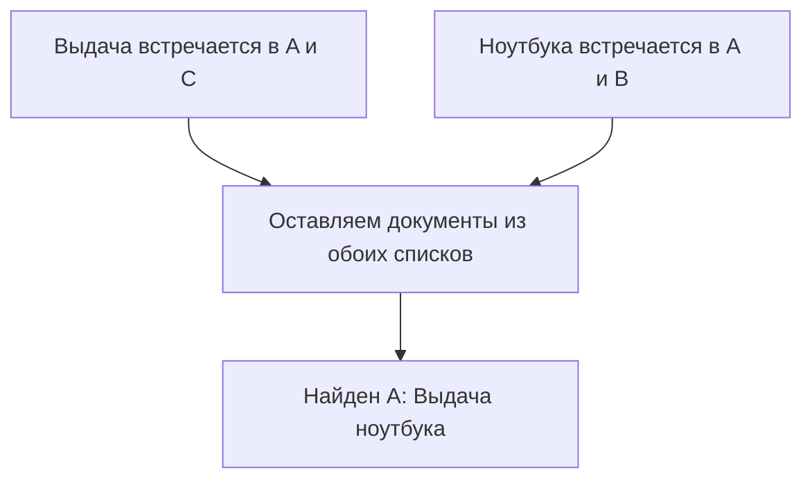
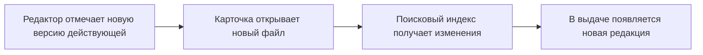

# Лекция 2.3. Принципы каталогизации и индексирования

**Дисциплина:** Основы работы с информацией.

**Раздел 2:** Организация, хранение и использование данных.

После лекции вы сможете объяснить, как устроен поиск по коллекции, составить запись каталога и проверить, почему в результатах оказался лишний документ или пропал нужный.

## 1. Что помогает найти нужный документ

Представьте, что перед занятием нужно найти действующие правила выдачи ноутбуков в колледже. В папке лежат «Правила.pdf», «Новые правила.pdf» и «Правила (копия).pdf». Какой файл открыть? По именам этого не определить. Хотелось бы сразу увидеть название, дату редакции и пометку «действует». В прошлой лекции такие сведения мы назвали **метаданными**.

**Каталог** — набор записей, по которым можно найти и различить объекты. Например, запись библиотеки показывает автора, название и издание книги. **Каталогизация** — составление таких записей по общим правилам. В [Национальной электронной библиотеке](https://rusneb.ru/how-to-search/) можно искать по автору и названию, а расширенный поиск позволяет уточнять условия. Это пример реального каталога, где качество описания влияет на результат.

*Рисунок 1 — Карточный каталог. В ящиках хранятся записи, по которым находят нужный материал.*

Для правил выдачи ноутбуков пригодятся поля из таблицы. Значения здесь учебные.

| Поле | Пример | Зачем нужно |
| --- | --- | --- |
| Идентификатор записи | RULE-017 | Найти ту же запись после переименования файла |
| Название | Правила выдачи учебных ноутбуков | Узнать документ в выдаче |
| Версия | 2 | Отличить редакцию от предыдущей |
| Статус | Действует | Выбрать документ, применимый сегодня |
| Ответственный | ИТ-отдел колледжа | Уточнить, какая редакция официальная |
| Адрес файла | Путь в хранилище | Открыть документ |

Слово «версия» здесь означает редакцию документа. Если файл той же редакции скопировали на другой диск, изменилась копия и её адрес. Если поменяли правила и утвердили новую редакцию, изменилась версия. В одной системе можно хранить общий идентификатор документа и отдельные номера редакций. Тогда сотрудник попадёт в карточку правил по стабильной ссылке и увидит, какая редакция действует.

### Что считать отдельной записью

Представьте электронную библиотеку. Один и тот же учебник издан в 2020 и 2024 годах. У нового издания другой состав глав, а преподаватель задал прочитать третью главу именно по нему. Для такого поиска важно различать издания. Если в фонде три одинаковых печатных экземпляра издания 2024 года, читателю достаточно одной записи об издании и сведений о доступных экземплярах. Библиотекарю, который выдаёт книгу, нужен ещё и номер конкретного экземпляра.

Вернёмся к колледжу. Правила выдачи ноутбуков могут состоять из основного документа и приложения с формой заявления. Если форма обновляется независимо и студенты часто ищут её отдельно, полезно завести отдельную карточку и связать её с правилами. Если она всегда действует только вместе с конкретной редакцией правил, связь с этой редакцией особенно важна. Иначе по поиску можно скачать новый бланк и приложить его к уже недействующим правилам.

Решение зависит от того, что человек должен уметь найти и чем ему предстоит управлять. Один объект может состоять из нескольких файлов. У одного файла может быть несколько копий. Прежде чем нумеровать записи, договоритесь, что представляет каждая из них и что происходит с идентификатором при замене файла.

## 2. Как люди отбирают материалы

В интернет-магазине можно сначала искать «наушники», а затем оставить беспроводные модели определённого бренда. Бренд, тип подключения и цена — отдельные признаки. Такой способ поиска называется **фасетной фильтрацией**. Фасет здесь означает одно измерение отбора, например формат файла или год. Можно выбрать несколько признаков сразу.

В каталоге колледжа можно искать по теме «ноутбуки» и одновременно оставить записи со статусом «действует». Для поля «статус» лучше договориться о списке значений. Если сотрудник вводит «действует», а коллега «актуально», простой фильтр по одному слову может пропустить запись. **Контролируемый словарь** — согласованный список терминов. Например, редакции получают один из статусов: «проект», «действует» или «архив».

Откройте [скриншот карточки книги в электронном каталоге Koha](https://commons.wikimedia.org/wiki/File:Screenshot-Koha_Online_Catalog_-_Mozilla_Firefox.png). Посмотрите, как на одной странице сгруппированы сведения о книге и ссылки для навигации. Такому представлению в бумажном каталоге соответствует отдельная карточка.

Есть и обратная задача: люди могут искать одно понятие по-разному. Студент напишет «вайфай», а в инструкции стоит «Wi-Fi». Чтобы оба запроса приводили к одной теме, можно сохранить варианты названия рядом с основным термином. При этом слишком широкая замена испортит выдачу. «Ноутбук» и «компьютер» пересекаются по смыслу, но правила выдачи ноутбуков вряд ли подходят для всех компьютеров.

### Рубрика, метка и фильтр

**Рубрика** — раздел каталога, который объединяет материалы по общему признаку. Например, «Оборудование» может содержать подразделы «Ноутбуки» и «Проекторы». Такая лестница рубрик удобна, когда человек просматривает коллекцию и ещё не знает точного названия нужного файла. Однако инструкцию по работе проектора с ноутбуком можно осмысленно отнести сразу к двум подразделам.

**Метка** — слово или короткая фраза, которую добавляют к записи, чтобы обозначить тему или свойство. Одному документу можно назначить метки «ноутбуки» и «проекторы», сохранив одну запись и один файл. При поиске по любой метке пользователь увидит документ. Если для одного понятия каждый сотрудник придумывает свои метки, результаты становятся неполными. Здесь пригодится договорённость о едином названии и допустимых вариантах поиска.

Фильтр полезен, когда пользователь уже понимает, какие ограничения ему нужны. Студент может выбрать «ноутбуки» и «действует», а администратор — «ноутбуки» и «архив». Коллекция у них одна, но цели разные. Проверять фильтры лучше на таких конкретных задачах. Так видно, нужны ли дополнительные поля и одинаково ли коллеги понимают их значения.

**Обсудите на занятии.** Какие два фильтра вы бы дали студенту, который ищет действующие правила? Какие поля нужны сотруднику, который сравнивает старую и новую редакции?

## 3. Как поисковая система находит совпадения

**Поисковый индекс** — подготовленная структура для быстрого поиска. В конце учебника можно открыть предметный указатель, найти термин и сразу перейти к нужным страницам. Поисковая система использует похожую идею для документов. **Индексация** — подготовка и обновление такого указателя.

Разберём маленькую коллекцию. Система знает три документа.

| Код | Название |
| --- | --- |
| A | Выдача ноутбука |
| B | Возврат ноутбука |
| C | Выдача проектора |

Если записать для каждого слова список документов, получится **инвертированный индекс**. Его называют так потому, что направление меняется: от слова к документам.

| Слово | Где встречается |
| --- | --- |
| выдача | A, C |
| ноутбука | A, B |
| возврат | B |
| проектора | C |

Запрос «выдача ноутбука» с условием «оба слова обязательны» оставит только A. Поиск сначала берёт два списка, затем находит общую запись. Указатель можно строить по названию, полному тексту или отдельным полям. Если в индекс попало только название, система может пропустить нужный документ, где слово встречается только в тексте.

Условие «хотя бы одно слово» даст A, B и C. Оно полезно, когда пользователь ищет варианты названия или ещё слабо знаком с темой. Для выдачи ноутбука этот вариант добавит лишние результаты. Отдельно работает поиск фразы. Допустим, в коллекцию добавили заголовок «Возврат ноутбука и выдача проектора». Оба слова присутствуют, но стоят в другом порядке и относятся к разным действиям. Чтобы отличать совпадение слов от совпадения фразы, поисковая система может хранить в индексе позиции слов.

Перед поиском слова часто приводят к виду, удобному для сравнения. Например, текст можно привести к нижнему регистру, чтобы «Выдача» и «выдача» совпали. Для точных кодов правила выбирают осторожно. Если для склада артикулы `0012` и `12` различаются, превращение кодов в числа сольёт две записи. Для поиска по тексту и поиска по артикулу могут понадобиться разные правила.

### Почему скан иногда не находится по словам

Файл PDF может содержать текст, который можно выделить мышью, или изображения отсканированных страниц. Когда на странице только изображение, поиск по её словам потребует **распознавания текста**. Программа пытается определить буквы по изображению и превращает их в текст, который можно добавить в индекс. На размытой странице она может принять единицу за букву или пропустить строку.

Например, секретарь ищет номер приказа. Запрос по названию находит карточку, а поиск по номеру из тела документа даёт пустую выдачу. Стоит открыть файл, проверить, выделяется ли номер как текст, и сравнить распознанный номер с тем, что видно на странице. Для важных номеров полезно вводить проверенное значение в отдельное поле каталога. Тогда поиск по номеру не зависит целиком от распознавания изображения.

Что делать пользователю, если результатов слишком много? Можно добавить конкретный признак, например год или статус. Синтаксис зависит от сервиса. В поиске Яндекса кавычки помогают искать фразу с заданной последовательностью слов. Для каталога колледжа сначала стоит проверить, поддерживает ли его поиск такой режим. [Справка Яндекса о поиске по словам и фразам](https://www.yandex.ru/support/search/ru/query-language/search-context).

## 4. Как проверить качество поиска

Система может найти правила выдачи, но поставить сверху архивную редакцию. **Ранжирование** — порядок результатов по тому, насколько они подходят к запросу. Одного совпадения по словам бывает мало: если пользователь ищет действующие правила, статус записи влияет на полезность результата. Фильтр убирает записи, которые не проходят условие, а ранжирование упорядочивает оставшиеся.

Допустим, для запроса подготовили учебную выборку. В каталоге есть 10 подходящих документов. Поиск показал 8, из которых подходят 6. Сразу возникают два вопроса: сколько полезного в выдаче и сколько полезного осталось за её пределами?

| Показатель | Как считать | Результат |
| --- | --- | --- |
| Точность | Подходящие найденные / все найденные | 6 из 8, или 75% |
| Полнота | Подходящие найденные / все подходящие в коллекции | 6 из 10, или 60% |

Фильтр может убрать два лишних результата и поднять точность. Чтобы найти четыре пропущенных документа, нужно выяснить причину пропуска. Например, у двух записей нет метки темы, а у остальных используется другое название. Тогда работа начинается с исправления записей и словаря. При измерении полноты заранее определите, какие документы подходят, иначе знаменатель для расчёта неизвестен.

### Как сравнить два варианта поиска

Возьмём ту же учебную коллекцию. Первый вариант показал 8 документов, из них 6 подходящих. Второй добавил поиск по вариантам названий и показал 12 документов, из них 9 подходящих. Точность в обоих случаях составляет 75%, а полнота выросла с 60 до 90%. При просмотре двенадцати результатов человек увидит на три подходящих документа больше, но встретит и на один лишний результат больше. Одного процента недостаточно, чтобы описать, что изменилось для пользователя.

Когда преподаватель проверяет, все ли обязательные инструкции найдены, пропуск одного документа важен. Когда студент ищет действующую форму заявления перед сдачей, для него важнее быстро увидеть верный результат. При оценке поиска полезно отдельно посмотреть, что стоит первым, и проверить несколько обычных запросов: по полному названию, по короткому слову, по номеру и по разговорному варианту.

## 5. Что делать, если каталог и поиск расходятся

Сотрудник ИТ-отдела загрузил новую редакцию правил и отметил старую как архивную. Коллега открыл карточку и видит новую версию, а через поиск по-прежнему находит старую. Возможная причина — индекс ещё не обновился. В системах поиска обновление индекса и сохранение данных могут происходить в разные моменты. [Документация Elasticsearch об обновлении видимости записей](https://www.elastic.co/guide/en/elasticsearch/reference/current/near-real-time.html).

*Между обновлением карточки и обновлением выдачи может пройти время.*

| Что наблюдаем | Что проверить |
| --- | --- |
| Из каталога открывается старая редакция | Какой файл связан с карточкой и какая версия отмечена действующей |
| В карточке всё верно, а в выдаче старая версия | Когда индекс получил изменения и по каким полям ищет |
| Файл есть, но студент не видит его в выдаче | Подходит ли запрос и есть ли у студента право видеть документ |
| Закрытый файл не открывается, но его название видно всем | Какие поля выводятся в результатах и где применяются правила доступа |

Последняя строка важна для безопасности. Представьте, что внутренний отчёт колледжа содержит фамилию студента в заголовке. Если поиск показывает этот заголовок всем, сведения раскрываются уже в выдаче. Права стоит проверять и для открытия файла, и для отображения его названия, фрагмента текста и других сведений в результатах. Поддержке полезно повторить поиск от лица пользователя с обычными правами и сравнить поведение с ожидаемым.

### Как проверить обновление после публикации

В учебной ситуации сотрудник колледжа сначала отмечает новую редакцию действующей и убеждается, что карточка ведёт к правильному файлу. Затем повторяет запросы «выдача ноутбуков» и «действующие правила» и смотрит, какая версия появляется в результатах. Если старая редакция должна остаться доступной сотрудникам, он проверяет, что её можно найти через фильтр «архив» и что её статус виден в карточке.

После изменения доступа проверку проводят для двух ролей. Сотрудник должен видеть доступный ему документ. Студент не должен видеть название, фрагмент текста и ссылку на закрытую запись. Если карточка уже закрыта, а название ещё появляется в результатах, ответственный за каталог передаёт в поддержку идентификатор записи, запрос, роль и время проверки. Эти сведения позволяют воспроизвести расхождение и проверить, где именно действуют ограничения.

### Что фиксировать в правилах каталога

В начале работы можно договориться всего о нескольких вещах. Кто добавляет карточки? Кто подтверждает, что новая редакция действует? Что происходит со старой версией? Какие поля должны появиться в поиске? Если ответы известны только одному человеку, при его отсутствии коллеги начнут заполнять записи по-разному. Например, один сотрудник заменит файл в старой карточке, а другой создаст вторую и забудет связать её с первой. Через месяц по общему названию будут открываться разные редакции.

Для передачи работы полезна короткая инструкция с примером записи. В ней можно указать обязательные поля, допустимые статусы и шаги проверки после изменения. Если каталог переносится в другое хранилище, проверьте вместе с файлами идентификаторы, связи между редакциями и права доступа. После переноса воспроизведите несколько знакомых запросов. Так можно заметить проблему, даже если все файлы были скопированы и открываются вручную.

Например, ответственный выбрал три контрольных запроса. По номеру должна открыться конкретная редакция, по теме должны появиться действующие правила и форма заявления, а запрос от имени студента должен показывать только доступные ему сведения. Список ожидаемых результатов можно записать заранее и пройти ещё раз после обновления каталога.

## Заключение

Каталог помогает разобраться, какие объекты есть в коллекции и как их различить. Индекс помогает искать по словам и признакам. Если результат оказался неверным, проверьте по порядку: существует ли нужная запись, верны ли её поля, успел ли обновиться индекс и что пользователь вправе увидеть.
