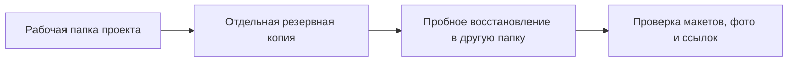

# Лекция 2.6. Организация хранилищ в облаке и на локальных устройствах

**Дисциплина:** Основы работы с информацией.

Небольшое проектное бюро готовит комплект материалов к выставке. Менеджер согласовывает смету из дома, дизайнер работает с большими изображениями в офисе, подрядчику нужны только утверждённые макеты. Перед поездкой дизайнер видит список файлов в проводнике и рассчитывает открыть их в поезде. Когда связь пропадает, часть файлов недоступна. Название было на экране, но сам файл находился только на сервере.

Такие ситуации удобно разбирать по трём вопросам. Где сейчас есть полное содержимое файла? Кто может его открыть или изменить? Откуда можно вернуть нужную версию, если рабочий экземпляр потеряется? Ответы зависят от настроек и организации работы. У одной и той же папки могут быть разные ответы для дизайнера, менеджера и подрядчика.

## 1. Где находятся данные

**Локальное хранилище** находится на устройстве, с которым человек работает, или на подключённом к нему носителе. Например, проект лежит на внутреннем диске ноутбука, а фотографии хранятся на внешнем диске. Чтобы открыть обычный локальный файл, достаточно исправного устройства и прав доступа. Интернет для этого не нужен. Если ноутбук сломается, а единственный экземпляр проекта был на его диске, команда рискует потерять работу.

**Сетевое хранилище** доступно по сети. В бюро может стоять собственный сервер, с которого сотрудники берут рабочие файлы. На компьютере этот ресурс иногда отображается как обычный диск, хотя содержимое хранится на другом устройстве. Если пропадёт связь с офисной сетью, такой диск может перестать открываться. Обслуживанием сервера, его обновлениями и резервными копиями занимается сама организация или привлечённый специалист.

**Облачное хранилище** — сервис, через который можно работать с файлами на удалённой инфраструктуре. Пользователь входит в учётную запись и открывает материалы через сайт или приложение. Например, менеджер открывает общую смету с домашнего компьютера, а дизайнер видит тот же проект в офисе. Возможность открыть файл из другого места зависит от связи, учётной записи и правил доступа. Облако тоже использует серверы и накопители. Пользователь обычно управляет папками, ссылками и доступом, а оборудование обслуживает поставщик сервиса.

| Место хранения | Как обычно открывается файл | Типичная причина недоступности |
| --- | --- | --- |
| Диск компьютера | Через папку на устройстве | Поломка, потеря или отсутствие доступа к компьютеру |
| Сервер организации | Через локальную сеть или разрешённое удалённое подключение | Пропала связь с сервером |
| Облачный сервис | Через приложение или сайт под учётной записью | Пропала связь, изменились права или недоступна учётная запись |

Проектное бюро может сочетать варианты. Например, исходные видео хранятся на офисном сервере. Сметы и текущие макеты лежат в общей библиотеке, доступной из разных мест. Для поездки сотрудник заранее сохраняет локальную копию необходимых материалов. Выбор зависит от размера файлов, частоты изменений и того, кто ими пользуется. Если файл нужен только для чтения на одном ноутбуке, ему не обязательно постоянно передаваться через интернет.

## 2. Что происходит при синхронизации

**Синхронизация** — обмен изменениями между хранилищем и устройствами. Сотрудник сохраняет новую версию файла, приложение передаёт изменения на сервер, а другие компьютеры получают их, когда подключаются. Этот процесс требует времени. Если файл большой или связь нестабильна, правка может появиться у коллеги позже, чем её сделал автор. До отправки ссылки полезно проверить, завершилась ли загрузка нужной версии.

Приложение может показывать уже известное имя файла, даже когда его содержимое ещё не загружено на компьютер. В OneDrive синий значок облака означает, что файл доступен через интернет. Зелёный кружок с белой галочкой отмечает файл, который настроен на постоянное хранение на этом устройстве. По этим значкам дизайнер может отличить файл, который нужно загрузить, от файла, подготовленного для поездки. На странице справки показаны реальные значки и их значения. [Значки состояния OneDrive](https://support.microsoft.com/ru-ru/onedrive/what-do-the-onedrive-icons-mean).

При подготовке к поездке недостаточно увидеть файлы в списке. Выберите нужную папку, сохраните её для работы без сети, дождитесь загрузки и попробуйте открыть несколько контрольных файлов при отключённой связи. Если макет ссылается на отдельные изображения, проверьте и их. Основной документ может открыться, а часть содержимого окажется пустой, если вспомогательные файлы остались на сервере.

**Конфликт версий** возникает, когда два изменения претендуют на одно место, а система не может автоматически их объединить. Представим, что менеджер без связи меняет цены в копии сметы, а коллега в офисе добавляет позиции в ту же смету. Когда оба устройства подключатся, приложение может сообщить о конфликте или сохранить отдельные варианты. Поведение зависит от сервиса, типа файла и настроек. Перед удалением одной из копий сравните изменения и определите, что перенести в общий документ.

У синхронизации есть ещё одно свойство: по сети могут распространяться и удаления. Если очистить папку, считая её локальной копией, удаление способно затронуть облачный экземпляр и другие устройства. В OneDrive освобождение места позволяет оставить файл в облаке, убрав загруженное содержимое с устройства. Перед такой операцией проверьте, что выбран именно этот режим и файлы доступны в сервисе. [Справка OneDrive о значках и доступности файлов](https://support.microsoft.com/ru-ru/onedrive/what-do-the-onedrive-icons-mean).

## 3. Как выдавать и отзывать доступ

**Права доступа** определяют, какие действия разрешены с ресурсом. Обычно различают просмотр и редактирование. Просмотр позволяет ознакомиться с материалом, а редактирование позволяет изменять его. Дополнительные действия, например скачивание, удаление или предоставление доступа другим людям, зависят от настроек сервиса. Поэтому слово «просмотр» не всегда означает запрет на скачивание.

У подрядчика в нашем примере одна задача: взять утверждённые макеты. Ему можно дать доступ к отдельной папке с готовыми файлами. Если вместо этого поделиться общей папкой проекта, там могут оказаться черновики, смета и переписка. Если подрядчик должен передать свои файлы в ответ, используйте отдельное место для приёма. Так право добавлять материалы не даёт доступ ко всему архиву бюро.

**Ссылка общего доступа** — адрес, который может открывать ресурс в пределах настроенных разрешений. В одном случае ссылка действует для конкретных участников. В другом её может открыть любой, кто получил адрес, если сервис и владелец разрешают такой режим. Пересланное письмо или сообщение может унести ссылку за пределы первоначальной группы. Прежде чем отправить её, проверьте, кому она даёт доступ и какие действия разрешает. [Общий доступ к файлам OneDrive](https://support.microsoft.com/ru-ru/onedrive/share-files-and-folders-in-microsoft-onedrive).

Права могут действовать сразу для целой папки. **Наследование прав** означает, что вложенный файл получает разрешения от папки, если правила хранилища не задают исключение. Например, папку проекта открыли всей команде, а затем сохранили внутрь смету с закрытыми ценами. Само имя «Конфиденциально» не меняет права. Перед переносом таких документов стоит проверить доступ в месте назначения и при необходимости выделить отдельную закрытую папку.

После завершения проекта пересмотрите ссылки и список приглашённых. Если подрядчик больше не участвует в работе, его право на вход можно убрать. Удаление доступа к облачному оригиналу не стирает копии, которые получатель успел сохранить. Поэтому при передаче материалов заранее определяйте, какие сведения можно выпускать за пределы команды.

## 4. Из чего восстанавливать потерянные данные

**Корзина** хранит недавно удалённые элементы, если сервис или устройство поддерживает эту возможность. **История версий** позволяет открыть прежнее состояние существующего файла. **Резервная копия** — отдельно сохранённый экземпляр данных, предназначенный для восстановления после потери рабочего экземпляра. У каждого способа свой сценарий. Если файл случайно удалили, первым делом полезно проверить корзину. Если файл открывается, но в нём пропала часть текста, полезнее история версий. Если исходное хранилище больше недоступно, важна независимая копия.

У корзины и истории версий есть ограничения. Хранилище может сохранять предыдущие состояния только определённое время. Возможность восстановления может зависеть от политики организации. Если данные повреждены давно, подходящая версия могла уже исчезнуть. Служба поддержки Microsoft отдельно описывает, как найти и восстановить раннюю версию файла в OneDrive. Перед использованием этой возможности полезно убедиться, что история включена и в ней есть нужный вариант. [Восстановление предыдущей версии в OneDrive](https://support.microsoft.com/ru-ru/onedrive/restore-a-previous-version-of-a-file-stored-in-onedrive).

Синхронизированные рабочие экземпляры удобно иметь на двух устройствах. Для восстановления после общей ошибки этого может быть недостаточно, потому что удаление или повреждённая версия способны распространиться на оба. Независимая резервная копия хранится так, чтобы ошибка рабочей среды не затронула её одновременно. Например, бюро хранит копию утверждённых материалов в отдельном месте с ограниченной записью. Если внешнее устройство используется только для копирования, его можно отключить между операциями.

Полезная модель планирования называется «три, два, один». Она предлагает иметь три экземпляра данных с учётом рабочего, хранить их на двух разных типах носителей и держать один экземпляр в другом месте. Другая площадка помогает, если происшествие затронуло весь офис. При выборе конкретного решения учитывайте объём и чувствительность материалов, а также то, сколько изменений допустимо потерять между копиями. [Рекомендации Австралийского центра кибербезопасности по резервным копиям](https://www.cyber.gov.au/sites/default/files/2023-06/Understanding-Ransomware-Threat-Actors_LockBit.pdf).

Работоспособность копии проверяют восстановлением. В отдельную папку возвращают несколько документов, открывают их привычными программами и проверяют даты, комплектность и доступ. Для выставочного проекта важно восстановить не только макет, но и изображения, на которые он ссылается. Если программа сообщает об успешном создании копии, но не может вернуть файл, задача восстановления не решена. [Руководство по испытанию восстановления](https://www.cyber.gov.au/ism/2026-09/guidelines-for-system-management).

На схеме видно, почему проверку проводят отдельно. Возвращённый комплект можно открыть и сравнить, пока рабочая папка остаётся на месте.

## 5. Как выбрать правила для своей команды

Сначала определите основное место каждого набора. Допустим, бюро хранит текущую смету в общей облачной библиотеке. Менеджеры редактируют один общий файл, а для подрядчика создают отдельную папку с утверждёнными материалами. Видео остаются на офисном сервере, потому что занимают много места. Для сотрудников, которые выезжают на площадку, заранее готовят перечень файлов для работы без связи. Ответственный проверяет, что список включает зависимости, например изображения из связанных папок.

Затем определите допустимые потери. Если смету правят несколько раз в день, копия недельной давности может вернуть слишком старые цифры. Для утверждённого макета, который больше не меняется, важнее хранить зафиксированный экземпляр и иметь возможность открыть его через несколько месяцев. Периодичность копирования следует выбирать по тому, сколько данных придётся вводить заново в случае сбоя. Срок хранения связан с тем, как быстро команда обычно замечает ошибку.

Представим, что утром дизайнер случайно удалил папку утверждённых макетов, а вечером менеджер заметил потерю. Сначала нужно выяснить, где была основная папка и дошло ли удаление до других устройств. Затем проверяют корзину сервиса. Если из неё можно вернуть папку, важно убедиться, что вернулась именно утверждённая редакция. Если корзина пуста, ищут независимую копию, восстанавливают в отдельное место и сверяют материалы с перечнем готовых файлов. После проверки ответственный возвращает восстановленный комплект команде.

Наконец, договоритесь о проверках, которые можно повторить. Для выезда попробуйте открыть файл без сети. Для внешней передачи проверьте доступ с ролью получателя. Для восстановления выберите контрольный проект и верните его из копии. Эти три действия отвечают на три разные задачи. Иногда оказывается, что рабочая папка удобна для доступа, но восстановление зависит от одного человека. Укажите в инструкции, кто отвечает за копии и где коллеги найдут порядок восстановления.

Правила полезно проверить и на смене сотрудника. Если все рабочие файлы хранились в личной папке одного человека, при уходе могут понадобиться перенос владения и новые права. Для материалов команды удобнее заранее выбрать общее рабочее пространство с назначенными ответственными. Тогда изменение состава группы не меняет адреса файлов и не оставляет проект без владельца. Доступы нового сотрудника всё равно проверяют отдельно: ему должны быть доступны именно те материалы, которые нужны для работы.

### Сколько работы придётся повторить после сбоя

Команда сохранила резервную копию во вторник в шесть вечера. В среду в десять утра менеджер заметил, что смета не открывается. После восстановления вторничной копии будут доступны сведения, сохранённые к шести вечера. Если утром коллега добавил три позиции, их придётся восстановить из других записей или внести заново. Здесь два разных вопроса: сколько свежих изменений потеряно и сколько времени займёт возвращение к работе. Копия может быть достаточно свежей, но очень медленно загружаться. И наоборот, устаревший файл можно вернуть быстро, хотя придётся повторить много ручной работы.

Для разных наборов нужны разные требования. Первичные фотографии, которые нельзя переснять, стоит скопировать вскоре после получения. Рабочие эскизы, которые легко восстановить, могут ждать очередного запуска. В перечне копируемых данных полезно отмечать, где лежит оригинал, откуда можно вернуть файл и кто проверяет восстановление. По этому списку второй сотрудник сможет продолжить работу, пока основной ответственный недоступен.

### Как проверить, что файл действительно отправился

Менеджер дал подрядчику ссылку на готовый макет. Подрядчик видит старый вариант, хотя в офисе новый уже открыт. Возможны разные причины. Дизайнер мог сохранить новый файл в обычные «Загрузки» и работать с ним, пока ссылка указывает на прежний экземпляр. Приложение могло ещё передавать изменения. Наконец, ссылку могли выдать на отдельную копию для подрядчика, которую нужно обновлять по правилам сдачи.

Диагностика начинается с простого: выясните, какой файл открыт у автора и куда ведёт ссылка. Затем откройте облачную версию через браузер и проверьте её название, дату и содержимое. Если новый файл виден у автора в сервисе, а подрядчик открывает прежний, проверьте адрес и права получателя. Например, удобно сравнить номер редакции на титульном листе. Дата изменения сама по себе может измениться и при другой операции, поэтому проверка содержимого надёжнее одного признака.

При регулярной передаче материалов можно закрепить последовательность. Сотрудник завершает правку, сохраняет утверждённый экземпляр в папку выдачи, сверяет его в хранилище и только затем отправляет ссылку. После обновления проверку повторяют. Такой порядок помогает даже при хорошей связи, потому что объединяет работу с версиями, адресом и правами доступа.

## Заключение

При выборе хранилища проверьте место хранения, доступ и путь восстановления. Синхронизация удобна для распространения рабочих изменений. Для поездки нужна заранее загруженная копия. Для совместной работы нужны понятные права. Для восстановления нужна сохранённая версия или независимая копия, которую удалось открыть и проверить.
